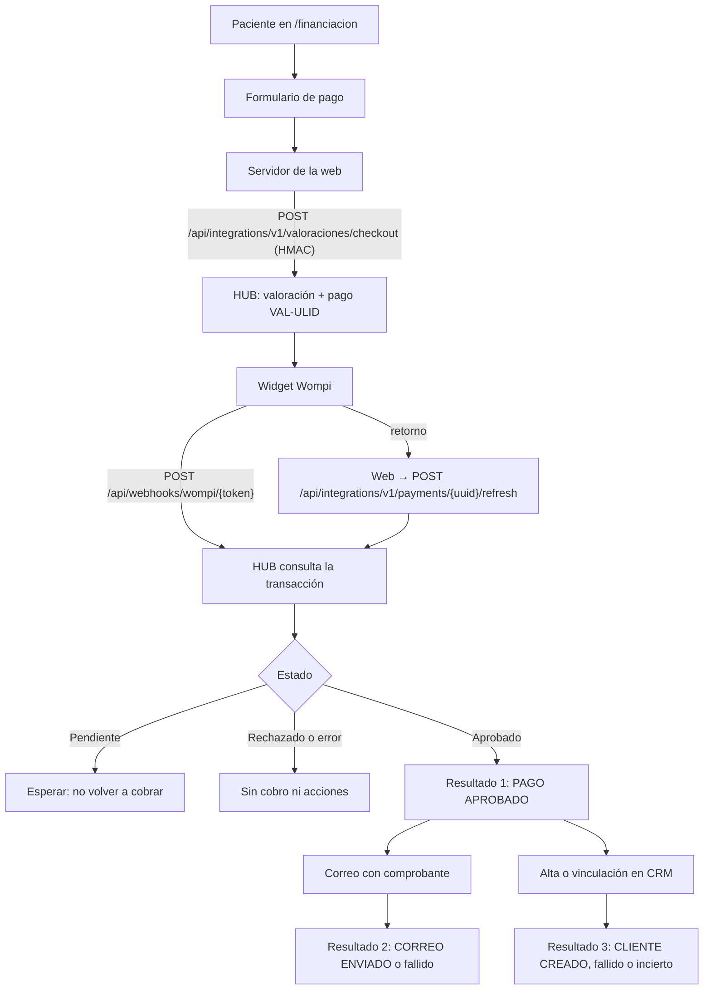

# Pago de valoración con Wompi en Planmed: documento de continuidad

- **Fecha:** 2026-11-26
- **Estado:** documentado; **nada implementado**.
- **Uso:** retomar la implementación y entregar requerimientos y resultados al desarrollador líder.

## Cómo leer este documento

| Etiqueta | Significado |
|---|---|
| **[C]** | Comprobado en código, Git o base local en la auditoría del 2026-11-26 |
| **[E]** | Confirmado por el equipo del proyecto (no comprobado en esa auditoría) |
| **[I]** | Inferido del código, sin reproducir |
| **[V]** | Requiere nueva verificación |
| **[P]** | Decisión o dato pendiente |
| **[R]** | Propuesta, no aprobada |

### Repositorios en el momento de la auditoría [C]

| Repositorio | Ruta local | Rama y commit | Nota |
|---|---|---|---|
| Planmed web | `C:\Users\pdtco\Desktop\planmed\planmed-web` | `release/crm-clientes-uat`, `3478639` | Con cambios sin commit ajenos a este tema (recursos, documentación de CRM) |
| HUB | `C:\xampp\htdocs\laravel\wellezy-hub-2` | `main`, `38d8797` | Con cambios sin commit, incluida la posaprobación |
| Crediestética web (solo referencia) | `C:\Users\pdtco\Desktop\crediestetica` | `c263586` | Árbol limpio |

---

## 1. Contexto

Incorporar en Planmed el pago en línea de la valoración que hoy existe como referencia en Crediestética, con identidad, configuración, empresa y línea propias. Planmed es la **empresa 3, línea 3** [C, base local]; verificar los identificadores en cada entorno [V].

### Referencia visual

En Crediestética, página `/financiacion`:

- **[C]** El bloque es una sección propia (`data-testid="valuation-cta"`) situada **justo después** de `#calculadora`, no dentro de ese contenedor. El botón y el formulario están en `components/forms/ValuationPayModal.vue`.
- Valor regular: **$300.000**. Valor pagando en línea: **$150.000**.
- Mensaje: «Paga tu valoración en línea y ahorra $150.000». Botón: «Pagar mi valoración».
- **[C]** Esos precios son visuales y fijos en `pages/financiacion.vue`. El importe cobrado lo pone la tarifa del HUB.
- **[C, 2026-11-26]** `https://crediestetica.com/financiacion` respondía 404: la referencia se revisó en el código [V].

Al pulsar el botón se abre un formulario, se paga con Wompi y, si el pago queda aprobado, se envía un correo con comprobante y se registra el cliente en el CRM Médico.

---

## 2. Regla fundamental

- Crediestética es **referencia**, no destino de cambios. **Está prohibido modificar su repositorio.**
- Publicar en producción su versión ya aprobada (fase 0) es un despliegue, no una modificación del código.
- El pago y la posaprobación dependen del HUB: copiar el componente visual no basta. **[C]** La web de Crediestética solo habla con el HUB y abre el widget de Wompi.
- Aprovechar lo que ya hace el HUB y generalizarlo por empresa y línea, **sin duplicar lógica ni condicionar por marca o `linea_id`**.
- El comportamiento actual de Crediestética debe conservarse.

---

## 3. Recorrido funcional

1. El paciente entra a la sección de financiación.
2. Elige pagar su valoración.
3. Completa el formulario.
4. La web envía los datos al HUB con una petición firmada (HMAC).
5. El HUB crea la valoración, genera la referencia (`VAL-` + ULID) y prepara la transacción.
6. La web abre el widget de Wompi.
7. El HUB confirma el resultado por webhook y/o consulta de estado; en ambos casos consulta la transacción a Wompi.
8. Con el pago aprobado, se ejecutan el correo y el alta en el CRM.

### Tres resultados distintos

| Resultado | Dónde se registra hoy [C] | Regla |
|---|---|---|
| Pago aprobado | `online_payments.status` | No depende del correo ni del CRM |
| Correo enviado | `valoracion_post_approvals.email_status` | No implica alta en el CRM |
| Cliente creado en el CRM | `valoracion_post_approvals.crm_status` | Un HTTP 2xx sin confirmación no basta |

### Estados del pago [C]

| Estado | Efecto |
|---|---|
| `PENDING` | Intento abierto; se reutiliza la referencia |
| `APPROVED` | Valoración pagada; se encola la posaprobación (si la línea está configurada) |
| `DECLINED` / `ERROR` | Terminal; 180 s antes de abrir otro intento |
| `VOIDED` | Solo desde aprobado; la valoración queda reembolsada. No deshace correo ni CRM |

Una segunda aprobación de la misma valoración queda marcada para conciliación; no hay reembolso automático.

---

## 4. Hallazgos de la auditoría del HUB

Fuente principal: `wellezy-hub-2/docs/architecture/analisis-posaprobacion-multilinea.md` (ruta local `C:\xampp\htdocs\laravel\wellezy-hub-2\docs\architecture\analisis-posaprobacion-multilinea.md`; **sin commit** en esa fecha).

- **[C]** La posaprobación admite **una sola línea** (`VALORACION_POST_APPROVAL_LINEA_ID`); en local es Crediestética, línea 4.
- **[C]** Contempla correo, comprobante PDF, alta en CRM y ejecución por colas (worker y scheduler).
- **[C]** No estaba versionada.
- **[C]** Marca, destinatario, textos, colores y datos del CRM dependen de Crediestética.
- **[C]** Con el código actual, un pago de Planmed aprobado quedaría **sin correo y sin alta en el CRM**.
- El HUB necesita configuración por empresa y línea. **No crear un proceso paralelo para Planmed.**

### Problemas identificados (todos **pendientes** de evaluación y resolución)

| # | Problema | Base |
|---|---|---|
| D1 | Un alta CRM interrumpida puede quedar en `processing` indefinidamente | [C] |
| D2 | Refrescar un pago antiguo tras activar una línea podría disparar la posaprobación. Verificar si se toca esa lógica | [I] |
| D3 | Un pago anulado con acciones pendientes puede reencolarse sin fin | [C] |
| D4 | El correo puede duplicarse si se reintenta sin saber si el envío anterior salió | [C] |
| D5 | Las operaciones `skipped` no se pueden reprocesar | [C] |

### Riesgo de despliegue [I]

La aplicación del pago escribe en columnas y tablas nuevas **dentro de la misma transacción**. Si se despliega el código antes de aplicar las migraciones `2026_11_21_100000`, `2026_11_23_100000` y `2026_11_23_110000`, **el procesamiento de pagos podría fallar**. Orden: migraciones, código, reinicio de workers (`php artisan queue:restart`) y verificación.

### Otros riesgos para la implementación

| # | Riesgo | Base |
|---|---|---|
| R1 | La web de referencia calcula su clave de reintento **sin cédula** y el HUB **con cédula**: corregir solo la cédula devuelve 409 hasta 30 min. No copiar ese fallo | [I] |
| R2 | No hay conciliación programada de pagos pendientes: sin webhook, un pago puede quedarse `PENDING` | [C] |
| R3 | La cédula no se usa para identificar al cliente del HUB en este checkout | [C] |
| R4 | Un dominio de retorno no registrado produce 422 y no hay checkout | [C] |
| R5 | Límites compartidos: HUB 20 checkouts/min por integración e IP del servidor web; la web, 5 cada 10 min por IP (configurar bien el proxy) | [C] |
| R6 | La idempotencia del checkout vive en caché (24 h) | [C] |

---

## 5. Decisiones confirmadas

### 5.1 Credenciales de correo

- **[E]** Hay indicios de que se han enviado correos de prueba con las identidades de Planmed y de Crediestética.
- **[C, revisión parcial]** En el código revisado del HUB no se encontró resolución de SMTP por empresa o línea: hay un mailer global, un mailer dedicado a BMQ (`.env`, sin commit) y la posaprobación usa el global. Cada web tiene además su propia configuración SMTP (`NUXT_MAIL_*`).
- **[I]** Los envíos de prueba pudieron salir de las webs y no del HUB.
- **[V]** Antes de diseñar, comprobar cómo se resuelve el SMTP por marca (código y configuración de cada entorno).
- **No asumir** que hacen falta credenciales nuevas en una tabla. Reutilizar el aislamiento existente si lo hay y no alterar la configuración de Crediestética.
- La recomendación del análisis (cuenta SMTP cifrada en base) queda **en suspenso** como [R] hasta esa verificación.

### 5.2 CRM Médico

- **[E]** El endpoint de creación de clientes se ha probado varias veces y el cliente se crea correctamente. Endpoint identificado: `/api/chat/create/client`.
- El pago debe reutilizar el mecanismo de creación de clientes que corresponda.
- **[C] Nota de evidencia:** en los repositorios, la prueba UAT documentada de Planmed es del formulario público (`/api/clients/forms`). Para `chat/create/client` no se encontró registro de las pruebas, y el documento `07-integracion-crm.md` del HUB todavía lo declara no confirmado.
- **Tarea técnica [V]:** dejar por escrito entorno, payload usado, `id_line`, respuesta de éxito (sin datos personales) y verificar errores dentro del flujo definitivo. Después, actualizar el documento 07.

### 5.3 Pagos anteriores

- **[E]** No hay pagos reales anteriores que migrar o reprocesar; los registros de prueba no requieren estrategia especial.
- El alcance son los registros nuevos. D2 y D5 se evalúan pensando en el futuro, no en recuperar históricos.

### 5.4 Trazabilidad

- Prioridad: que los procesos funcionen. En la primera versión basta identificar resultados en los logs.
- Historial detallado y paneles: **fuera** de la primera implementación (incluida la tabla de intentos propuesta en el análisis).
- **[C]** Hoy el CRM registra todos sus resultados en log, pero el **envío correcto del correo no genera log** (solo los fallos; el éxito queda en la tabla). Añadirlo es tarea de implementación.
- Que un proceso falle no debe impedir el otro.

### 5.5 Fallos independientes

| Requisito | Situación actual [C] |
|---|---|
| El pago sigue aprobado si falla el correo o el CRM | Cumple |
| Un fallo de correo no impide el CRM, ni al revés | Un error capturado no lo impide; ambos van **en secuencia en el mismo job**, así que un correo colgado puede retrasar el CRM |
| Reintento seguro sin volver a cobrar | Parcial: job y comando cada 10 min; D1, D4 y D5 pendientes |
| Reintentos sin clientes duplicados | Parcial: un resultado incierto del CRM no se reenvía; dos pagos de la misma persona o un alta previa por formulario **no** están cubiertos (sección 9) |

---

## 6. Correo de Planmed

Usar las credenciales y la identidad de envío de Planmed. Nunca plantillas ni remitentes de Crediestética.

| Etapa | Destinatario | Condición |
|---|---|---|
| 1 · Pruebas internas | **Exclusivamente** `maicoll4966@gmail.com` | Sin CC ni copias a nadie más |
| 2 · Definitivo | `disenadoraplanmed@gmail.com` | Solo tras verificar y con **autorización expresa**; nunca automático |

Verificar en la etapa 1: recepción, remitente e identidad visual, contenido y plantilla, datos del paciente, datos de la valoración, comprobante PDF y reintentos.

- No enviar pruebas a pacientes reales ni a otros destinatarios. Usar datos de prueba.
- **[C]** El correo actual es interno (no se envía al paciente); su `Reply-To` es el correo informado por el paciente.
- **[R]** Que el HUB fuerce el destinatario único en modo pruebas justo antes de enviar (precedente: modo `testing` de BMQ).
- **[C]** Colores del correo actual de la web de Planmed: cabecera `#0C2619`, acento `#d3a76a`.
- **[C]** El texto actual menciona «Convenios» y «correo maestro del CRM»: no heredarlo sin revisarlo.

---

## 7. Configuración Wompi de Planmed

**[C]** En local, la línea 3 no tiene cuenta Wompi, tarifa ni integración firmada; su único dominio registrado es `planmed.com.co`. Otros entornos [V].

| Elemento | Qué verificar o configurar |
|---|---|
| Cuenta Wompi | La que corresponda a Planmed [P] |
| Administración | Ya existe en el HUB (`/pagos/cuentas-wompi`, `app/Livewire/Payments/WompiAccounts`): por empresa y línea, una activa por ambiente. Revisarla antes de proponer cambios o tablas |
| Llaves y secretos | Pública, privada, integridad y eventos. Se guardan cifrados en `wompi_accounts`. Registrarlos solo por persona autorizada; nunca en documentos, chats ni Git |
| Ambiente | **[C]** `WOMPI_ENVIRONMENT` es **global del HUB** (`config/payments.php`, por defecto `sandbox`), no por línea. **[I]** Un mismo HUB no puede cobrar Crediestética en producción y probar Planmed en sandbox a la vez: las pruebas necesitan un entorno aparte |
| Webhook | `POST /api/webhooks/wompi/{webhook_token}` de la cuenta, registrado en el panel de Wompi. No exponer el token |
| Tarifa | Registro vigente en `valoracion_tarifas`; debe coincidir con el precio mostrado |
| Referencia | La genera el HUB (`VAL-` + ULID) |
| Firma y estado | Firma de integridad en el widget; firma del evento en el webhook; consulta de la transacción validando referencia, importe, moneda y estado |
| Integración web ↔ HUB | `php artisan integrations:create 3 "<nombre>"` (confirmar el id de línea del entorno) |
| Dominios de retorno | Todos los usados (incluido UAT) en los dominios de la línea |

Guías existentes en el HUB: `docs/modules/pagos/tutoriales/` (01 configurar cuenta, 02 habilitar pagos, 03 pruebas y producción).

---

## 8. Adaptación de la web de Planmed

**[C] Hoy:** `pages/financiacion.vue` tiene la sección `#calculadora` con `<SimulatorPanel />`; no hay bloque de pago ni integración Wompi. El `#calculadora` publicado en `planmed.wellezyhub.com` tampoco tiene pago; `planmed.com.co/financiacion` mostraba otra versión sin ese ancla [V].

### Debe contemplar

- Bloque de pago junto al simulador, con identidad de Planmed (`#0C2619` / `#D3A76A`), adaptable a móvil y accesible.
- Precio regular y especial, **sujetos a confirmación comercial** [P].
- Formulario. En la referencia [C]: nombre (2–100), cédula (5–12 dígitos), celular (7–15 dígitos), correo y aceptación de la política de datos, todos obligatorios.
- Validación en navegador y servidor; mismo origen y límite de intentos.
- Checkout y confirmación mediante el servidor de la web, firmados hacia el HUB. El navegador no fija el importe ni ve secretos.
- Widget de Wompi y tratamiento de pendiente (verificar sin volver a pagar), aprobado, rechazado, error y anulado (no decir «no se realizó ningún cobro»).
- Recuperación del estado al volver de una redirección.

### Archivos previstos [R]

| Acción | Archivo |
|---|---|
| Crear | `components/forms/ValuationPayModal.vue`, `shared/utils/valuationPay.ts` |
| Crear | `server/utils/valuationPayment.ts`, `server/api/forms/valuation-payment/{checkout,confirm}.post.ts` |
| Crear | Pruebas del formulario y de las rutas con HUB simulado |
| Modificar | `pages/financiacion.vue`, `nuxt.config.ts` (variables privadas de integración; revisar antes sus cambios sin commit), `.env.example` |

Reutilizable [C]: `server/utils/origin.ts` (`assertSameOrigin`), utilidades de `server/utils/formMail.ts` (errores y límite por IP).

**[P]** `pages/testimonios/index.vue` ofrece «valoración gratuita», en conflicto con una valoración pagada.

No copiar configuraciones, credenciales ni identificadores de Crediestética, ni importar código desde su carpeta.

---

## 9. Clientes y CRM

Documentación: `docs/integrations/crm-medico-clientes.md` (este repositorio) y `wellezy-hub-2/docs/integrations/clientes-y-crm-medico.md` (ambas con cambios sin commit en esa fecha).

### Comparación [C]

| | Pago (HUB, `CrmClientRegistrar`) | Formulario público de valoración Planmed | Antes en Planmed (`43c210c`, reemplazado) |
|---|---|---|---|
| Endpoint | `CRM_CLIENT_URL` (previsto `/api/chat/create/client`) | `/api/clients/forms` | `/api/chat/create/client` |
| Formato | JSON | multipart con sesión y token CSRF | JSON |
| Datos | `name`, `phone` (`57…`), `identificacion`, `ad_headline` = «formulario web», `advisor_email`, `id_line` | 17 campos | Además `city`; `+57…`; titular «Quiero más info»; `id_line` 12 |
| Éxito | Marca positiva explícita (criterio provisional) | Texto en `mensagge` | Marca positiva |
| Incierto | No se reenvía | Control de duplicados en memoria | — |

Otras vías [C]: los micrositios `/prp/[slug]` envían directo al CRM y no deben pasar por el HUB (no tocar); `/api/forms/valuation` de la web no llama al HUB.

### Clientes en el HUB [C]

- El checkout busca o crea el cliente por teléfono o correo dentro de la empresa; el documento queda en la valoración, no se usa para buscar (R3).
- Hay cambios recientes sin commit sobre unicidad y tipos de documento; las migraciones se aplicaron solo en local [V].
- No se guarda ningún identificador del cliente creado en el CRM.

### Riesgo de segunda ficha [I]

Un paciente que ya envió un formulario público existe en el CRM; un alta tras el pago podría duplicarlo. **Un paciente nuevo para el pago no es necesariamente un cliente nuevo para el CRM.**

La estrategia debe definir, según las reglas de clientes del HUB:

1. **Búsqueda** previa por documento, teléfono o correo. **[V]** `CrmedicClient` permite consultar pacientes, pero no está confirmado que sea el mismo sistema.
2. **Vinculación** del pago con el cliente existente.
3. **Idempotencia** ante reintentos, eventos repetidos y varias valoraciones de una persona.
4. **[V]** Qué hace `chat/create/client` ante un cliente ya existente.

---

## 10. Secuencia de trabajo acordada

La implementación **no** comienza todavía.

### Fase 0 · Actualización de producción

1. Actualizar el HUB según el procedimiento de despliegue aprobado.
2. Actualizar la web de Crediestética.
3. Actualizar la web de Planmed.
4. Verificar ambas webs.
5. Confirmar que no cambió su comportamiento.

No incluir la nueva integración Wompi de Planmed mientras no esté aprobada e implementada.

**Antes de ejecutar la fase 0, resolver [P]:**

- **Qué versión se publica.** [C] La posaprobación está sin commit en el HUB, y en el flujo de pago la web actual de Crediestética ya no envía correo ni alta CRM por su cuenta. Publicarla sin esa parte del HUB dejaría pagos aprobados sin correo ni CRM; el documento `docs/crediestetica/valoraciones-pagos/13-despliegue-y-lista-de-verificacion.md` pide desplegar el HUB primero o ambos juntos.
- Los árboles del HUB y de Planmed mezclan cambios de varias tareas: decidir qué entra y respetar el riesgo de migraciones (sección 4).
- **[C, 2026-11-26]** `crediestetica.com` publicaba una versión antigua: comparar antes de reemplazarla [V].

### Fase 1 · Diseño del HUB

1. Revisar el estado actual del HUB.
2. Confirmar cómo funciona el correo por empresa y línea.
3. Definir la configuración dinámica de posaprobación.
4. Evaluar D1–D5.
5. Definir la separación entre correo y CRM.
6. Definir reintentos e idempotencia.
7. **Aprobar el diseño antes de implementar.**

### Fase 2 · Implementación en el HUB

Motor dinámico sin código duplicado por marca; Crediestética igual que hoy; configuración de Planmed.

### Fase 3 · Web de Planmed

Bloque visual, formulario y conexión con Wompi.

### Fase 4 · Pruebas internas

- [ ] Wompi en ambiente de pruebas (ver la restricción de ambiente en la sección 7).
- [ ] Pago aprobado, rechazado y pendiente.
- [ ] Correo exclusivamente a `maicoll4966@gmail.com`.
- [ ] Creación y vinculación del cliente en el CRM, con datos de prueba autorizados.
- [ ] Fallos independientes de correo y de CRM.
- [ ] Reintentos e idempotencia.
- [ ] Sin cobros ni clientes duplicados.
- [ ] Webhook sin navegador (cerrar antes del retorno).
- [ ] Crediestética sin cambios.

### Fase 5 · Correo definitivo

Solo con verificación y autorización: cambiar a `disenadoraplanmed@gmail.com` y validar el envío.

---

## 11. Decisiones pendientes

| # | Pendiente |
|---|---|
| 1 | Precio definitivo de la valoración de Planmed (regular y en línea) |
| 2 | Cuenta Wompi y ambiente inicial, y entorno donde probar |
| 3 | Identificador de línea y asesora que requiere el CRM Médico |
| 4 | Configuración definitiva del correo de Planmed (según la verificación de 5.1) |
| 5 | Plantilla y contenido del correo |
| 6 | Reglas comerciales de la valoración (incluidas anulaciones, dobles pagos y el texto «valoración gratuita») |
| 7 | Tratamiento de clientes ya existentes en el CRM |
| 8 | Configuración dinámica de posaprobación a adoptar. [R] Perfil por empresa y línea con respaldo de la configuración actual (ver análisis del HUB) |
| 9 | Versiones y cambios que entran en la fase 0 |
| 10 | Datos del formulario: si el CRM exige `city` u otros campos |

Ya confirmado y que **no** se vuelve a preguntar: destinatarios de prueba y definitivo, ausencia de pagos históricos que reprocesar, trazabilidad básica en la primera versión, independencia entre pago, correo y CRM.

---

## 12. Estado de la implementación

| Elemento | Estado |
|---|---|
| Auditoría de Crediestética | Realizada |
| Auditoría inicial de posaprobación del HUB | Realizada (sin ejecutar pruebas ni revisar producción) |
| Documento de arquitectura del HUB | Existe, sin commit |
| Problemas D1–D5 | Pendientes |
| Verificación del correo por marca | Pendiente |
| Configuración dinámica de posaprobación | Pendiente |
| Implementación de Planmed en el HUB | Pendiente |
| Bloque de pago en la web de Planmed | Pendiente |
| Endpoint de creación de clientes del CRM | Probado según el equipo; verificar dentro del flujo de pago |
| Cuenta Wompi de Planmed | Por verificar |
| Precio definitivo de Planmed | Por confirmar |
| Correo de pruebas | Definido |
| Correo definitivo | Definido, activación pendiente |
| Actualización de producción (fase 0) | Pendiente |
| Pruebas integrales del flujo de Planmed | Pendientes |
| Activación en producción | Pendiente |

---

## 13. Cómo retomar esta implementación

1. Leer **primero** este documento.
2. Consultar `analisis-posaprobacion-multilinea.md` del HUB. Donde difiera de las decisiones de la sección 5, **prevalece este documento**.
3. Revisar el estado actual de los repositorios (rama, commit, cambios sin commit) antes de proponer cambios.
4. No asumir que el código o la configuración siguen como en la auditoría inicial.
5. Identificar la fase actual (sección 10) y las decisiones aún pendientes (sección 11).
6. **No modificar Crediestética**; usarla solo como referencia de comportamiento.
7. Implementar en Planmed y en el HUB **únicamente** lo previamente aprobado.
8. No mezclar esta implementación con otros módulos o proyectos.
9. No desplegar, no hacer pagos reales, no enviar correos ni registros reales al CRM sin autorización expresa.
10. Actualizar este documento al cerrar cada fase o decisión.
