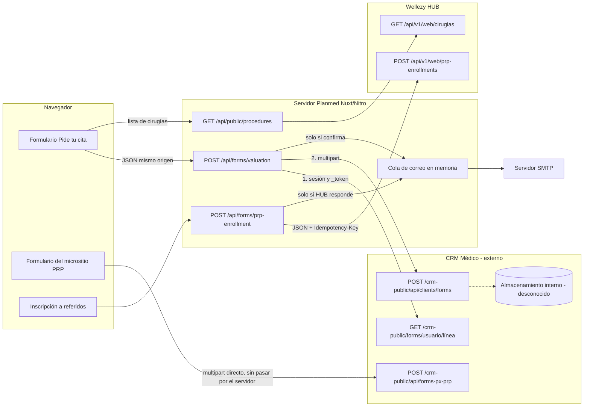
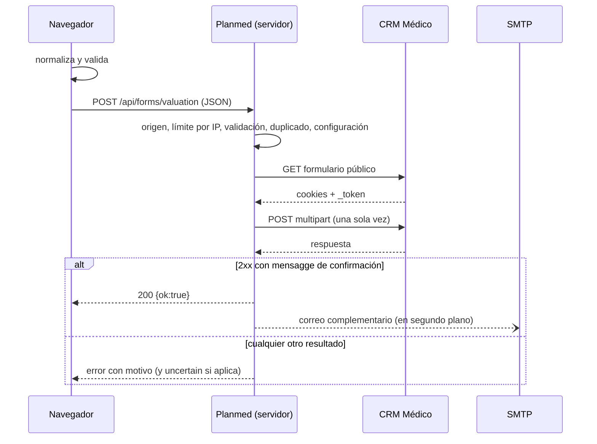

# Planmed → CRM Médico: registro de pacientes (lado emisor)

Documento de referencia de esta integración. Si otro documento dice algo distinto sobre este envío, prevalece este; si este contradice el código, prevalece el código.

- **Fecha de la auditoría:** 2026-11-26.
- **Código auditado:** `planmed-web`, rama `release/crm-clientes-uat`, commit `3478639`, árbol limpio al empezar.
- **Lado HUB:** `wellezy-hub-2` → `docs/integrations/clientes-y-crm-medico.md` (en la máquina de desarrollo auditada, `C:\xampp\htdocs\laravel\wellezy-hub-2\docs\integrations\clientes-y-crm-medico.md`). Los dos repositorios no comparten raíz, por eso no hay un enlace relativo portable.
- **CRM Médico** es un sistema externo. No tenemos su código: nada de lo que ocurre dentro de él está verificado.

## Índice

1. [Niveles de evidencia y estado](#1-niveles-de-evidencia-y-estado)
2. [Arquitectura y flujos](#2-arquitectura-y-flujos)
3. [Piezas de código](#3-piezas-de-código)
4. [Recorrido de la valoración](#4-recorrido-de-la-valoración)
5. [Sesión y CSRF](#5-sesión-y-csrf)
6. [Contrato de envío](#6-contrato-de-envío)
7. [Diccionario de datos](#7-diccionario-de-datos)
8. [Transformaciones y validaciones](#8-transformaciones-y-validaciones)
9. [Identificadores y configuración](#9-identificadores-y-configuración)
10. [Respuestas, errores y duplicados](#10-respuestas-errores-y-duplicados)
11. [Correo complementario](#11-correo-complementario)
12. [Responsabilidades de Planmed](#12-responsabilidades-de-planmed)
13. [Otros flujos de datos personales de Planmed](#13-otros-flujos-de-datos-personales-de-planmed)
14. [Reglas para futuras integraciones](#14-reglas-para-futuras-integraciones)
15. [Seguridad y trazabilidad](#15-seguridad-y-trazabilidad)
16. [Pruebas](#16-pruebas)
17. [Diagnóstico](#17-diagnóstico)
18. [Inconsistencias detectadas](#18-inconsistencias-detectadas)
19. [Límites de conocimiento y aspectos pendientes](#19-límites-de-conocimiento-y-aspectos-pendientes)

## 1. Niveles de evidencia y estado

| Etiqueta | Significado |
|---|---|
| **Código** | Comprobado leyendo el commit auditado |
| **Prueba** | Comprobado con pruebas automatizadas (CRM y SMTP simulados) |
| **UAT** | Observado en la prueba UAT, **según lo reportado por el equipo**; esta auditoría no revisó el CRM, el buzón ni el servidor |
| **Contrato externo** | Visto en el HTML público del formulario del CRM (`GET` del 2026-11-25) o en una solicitud o respuesta real anterior |
| **Desconocido** | No verificable sin acceso al CRM Médico |

### Evidencia UAT reportada

El **26 de noviembre de 2026** se hizo una prueba de valoración:

- el registro del paciente fue confirmado en CRM Médico;
- el correo `[Planmed] Nueva solicitud de valoración` se recibió en Gmail;
- el correo salió por el SMTP de Hostinger;
- valores configurados: `id_user = 73`, `id_line = 16`, `id_user_asesora = 73`; el envío usa `state = No Contactada` y `origen = Formulario Web`.

Lo que esa evidencia **no** dice: qué commit estaba desplegado, qué forma de pago se envió, el código HTTP ni el cuerpo exacto de la respuesta, ni cómo quedó cada campo dentro del CRM.

## 2. Arquitectura y flujos

Solo se dibujan conexiones demostradas en código.



**No existe** conexión de la valoración hacia HUB: el paciente de la valoración no se guarda en HUB (**Código**). HUB solo aporta la lista de cirugías. La integración omnicanal de HUB (`/api/internal/omnichannel/contact`) es otro flujo: Planmed no la llama.

## 3. Piezas de código

| Pieza | Archivo | Función principal |
|---|---|---|
| Formulario público (en todas las páginas salvo las PRP) | `components/forms/ValuationRequest.vue`, montado en `layouts/default.vue` | `onSubmit` |
| Llamada desde el navegador | `services/ValuationService.ts` | `submit`, `toError` |
| Validación compartida y formas de pago | `shared/utils/valuation.ts` | `normalizeValuation`, `validateValuation`, `PAYMENT_OPTIONS` |
| Ruta | `server/api/forms/valuation.post.ts` | delega en `handleValuation` |
| Reglas, duplicados, respuestas y correo | `server/utils/valuation.ts` | `handleValuation`, `failFromCrm`, `crmFieldErrors`, `buildValuationEmail`, `notifyValuationByEmail` |
| Cliente del CRM | `server/utils/crmClient.ts` | `resolveCrmClientConfig`, `openCrmSession`, `buildCrmFields`, `registerCrmClient`, `crmConfirmed`, `classifyCrmError` |
| Control de origen | `server/utils/origin.ts` | `assertSameOrigin` |
| Correo | `server/utils/formMail.ts` | `resolveMailConfig`, `notifyComplementary`, `deliverFormMail` |
| Configuración | `nuxt.config.ts` (`runtimeConfig`), `.env.example` | |
| Lista de cirugías | `server/api/public/procedures/index.get.ts` | `wellezyPublicGet('/v1/web/cirugias')` |
| Pruebas | `tests/security/valuation.test.ts`, `tests/security/crm-client-log.test.ts` | |

Documentación previa relacionada (resúmenes que enlazan aquí): `documentacion/CREDIT_STUDY_FORM_INTEGRATION.md`, `documentacion/documentacion-maestra-planmed/` (07 §3.5, 16 y F10) y `documentacion/guias/01-guia-pagina-publica.md`.

## 4. Recorrido de la valoración



Orden en `handleValuation` (**Código**, **Prueba**):

1. `assertSameOrigin` → 403.
2. Límite de 8 intentos cada 10 minutos por IP → 429 `rate_limited`.
3. `normalizeValuation` + `validateValuation` → 422 `validation`.
4. Huella de cédula y teléfono contra envíos inciertos, en curso o recientes → 409 `duplicate`.
5. `resolveCrmClientConfig` → 503 `not_configured`.
6. `registerCrmClient`: `GET` y, si hay sesión, un único `POST`.
7. Confirmado: se anota la huella, se lanza el correo sin esperarlo y se responde `{ok:true}`.

El navegador muestra «¡Gracias! Recibimos tu solicitud.» solo si recibe `ok: true`; conserva los datos escritos ante cualquier error.

## 5. Sesión y CSRF

La descripción «GET previo → cookies y token → POST multipart → interpretar respuesta» **coincide con el código** (`openCrmSession` y `registerCrmClient`).

| Elemento del formulario público | Detalle | Evidencia |
|---|---|---|
| URL de referencia | `https://pdtclientsolutions.com/crm-public/forms/73/16` | Contrato externo |
| Respuesta | `200`, `text/html`, sin autenticación | Contrato externo |
| Cookies | `XSRF-TOKEN` y `laravel_session` (`httponly`), `Max-Age=7200` | Contrato externo |
| Token | `<input type="hidden" name="_token">`, 40 caracteres | Contrato externo |
| Envío original | AJAX a `{ruta}/api/clients/forms` con `FormData`; muestra `respuesta.mensagge` | Contrato externo |

En **cada** envío Planmed:

1. Hace `GET` del formulario (`Accept: text/html`, sin cookies ni datos, `redirect: 'manual'`, 15 s).
2. Exige estado `200`, al menos una cookie (`cookieHeader`) y un `_token` de 16 a 256 caracteres válidos (`extractCsrfToken`).
3. Hace `POST` con `Accept: application/json`, `Cookie`, `X-Requested-With: XMLHttpRequest`, `Origin` y `Referer`.

Cookies y token viven en memoria solo durante ese envío. Si falla el paso 1 o 2 **no se envía ningún dato del paciente** (503 `crm_session`).

## 6. Contrato de envío

| Elemento | Valor | Evidencia |
|---|---|---|
| URL | `POST https://pdtclientsolutions.com/crm-public/api/clients/forms` (llega por configuración) | Contrato externo / Código |
| Formato | `multipart/form-data`; `boundary` generado por `fetch` | Código / Prueba |
| Redirecciones | No se siguen | Código / Prueba |
| Tiempo máximo | 15 s por solicitud (hasta 30 s en total) | Código |
| Reintentos | Ninguno | Código / Prueba |
| Éxito conocido | `{"mensagge": "Los datos fueron registrados satisfactoriamente"}` | Contrato externo |
| Código HTTP del éxito y formato de los errores | — | Desconocido |

## 7. Diccionario de datos

Orden exacto de `buildCrmFields`. «Obligatorio» se refiere al formulario de Planmed; qué exige el CRM es **desconocido**. Responsable: quien produce el valor.

| Origen en Planmed | Campo CRM | Transformación | Obligatorio | Responsable | Evidencia |
|---|---|---|---|---|---|
| `GET` del formulario | `_token` | Ninguna; distinto en cada envío | Sí (automático) | CRM lo emite, Planmed lo devuelve | `openCrmSession`, `extractCsrfToken` |
| Constante | `_method` | `post` | Constante | Planmed (código) | `buildCrmFields` |
| «Nombres» | `nombres` | Recorte, caracteres de control y espacios repetidos eliminados | Sí | Usuario | `normalizeValuation`, `oneLine` |
| «Apellidos» | `apellidos` | Igual que `nombres` | Sí | Usuario | `oneLine` |
| «Número de cédula» | `identificacion` | Solo recorte | Sí | Usuario | `validateValuation` |
| «Fecha de nacimiento» | `fecha_nacimiento` | Ninguna: `AAAA-MM-DD` | Sí | Usuario | `validateValuation` |
| **«Ciudad»** | `direccion` | Igual que `nombres` | Sí | Usuario | `buildCrmFields` |
| «Teléfono» | `telefono` | Solo dígitos; no añade ni quita indicativo | Sí | Usuario | `buildCrmFields` |
| «Email» | `email` | Solo recorte (no se pasa a minúsculas) | Sí | Usuario | `buildCrmFields` |
| Cirugía elegida | `name_surgery` | Nombre visible; espacios normalizados | Sí | Lista de HUB | `ValuationRequest.vue`, `oneLine` |
| «Forma de pago» | `forma_pago` | `Contado` → `Contado`; `Financiación` → `Financiacion` | Sí | Usuario | `PAYMENT_OPTIONS` |
| Constante | `state` | `No Contactada` | Constante | Planmed (`CRM_FORM_STATE`) | `buildCrmFields` |
| Constante | `origen` | `Formulario Web` | Constante | Planmed (`CRM_FORM_ORIGIN`) | `buildCrmFields` |
| Configuración | `id_user` | Entero positivo; por defecto `73` | Sí | Entorno | `resolveCrmClientConfig` |
| Configuración | `id_line` | Entero positivo; por defecto `16` | Sí | Entorno | `resolveCrmClientConfig` |
| Configuración | `id_user_asesora` | Entero positivo; por defecto `73` | Sí | Entorno | `resolveCrmClientConfig` |
| Casilla de política de datos | `accept` | `1`; sin aceptación no se envía | Sí | Usuario | `buildCrmFields` |

No hay campos opcionales: los diez campos del formulario son obligatorios. Los campos desconocidos que lleguen en el JSON se descartan.

## 8. Transformaciones y validaciones

La misma función valida en navegador y servidor (`validateValuation`). El servidor es la autoridad.

| Campo | Regla |
|---|---|
| Nombres, apellidos, ciudad | 2 a 100 caracteres |
| Cédula | `^[A-Za-z0-9]{5,20}$` (sin puntos ni espacios) |
| Fecha de nacimiento | Formato `AAAA-MM-DD`, fecha real, no futura, año ≥ 1900 |
| Teléfono | Dígitos, `+`, espacios, paréntesis o guiones; de 7 a 15 dígitos |
| Email | Forma básica de correo, máximo 150 |
| Cirugía | Obligatoria, máximo 150. **El servidor no comprueba que pertenezca a la lista de HUB** |
| Forma de pago | `Contado` o `Financiación` |
| Aceptación | Debe ser exactamente `true` |

- **Teléfono:** al CRM llega como lo escriba la persona, solo dígitos: `+57 300…` y `300…` producen valores distintos. La huella antiduplicados (`phoneKey`) sí los iguala quitando el `57` de un celular colombiano, pero ese ajuste **no** se envía.
- **Forma de pago:** en el formulario del CRM es un campo de **texto libre** rotulado «Forma de pago (Contado/Financiación)». `Financiacion` sin tilde se observó en una solicitud real; `Contado` sigue el rótulo. Planmed no supone ningún catálogo interno.
- **Cédula:** en la huella se pasa a mayúsculas; al CRM se envía como se escribió.

## 9. Identificadores y configuración

| Valor | Variable de entorno | `runtimeConfig` | Dónde se define |
|---|---|---|---|
| Destino | `NUXT_CRM_FORM_URL` | `crmFormUrl` | Solo entorno; vacío por defecto. **Obligatoria** |
| `id_user` | `NUXT_CRM_FORM_USER_ID` | `crmFormUserId` | `73` en `nuxt.config.ts`, sustituible por entorno |
| `id_line` | `NUXT_CRM_FORM_LINE_ID` | `crmFormLineId` | `16`, igual |
| `id_user_asesora` | `NUXT_CRM_FORM_ADVISOR_ID` | `crmFormAdvisorId` | `73`, igual |
| `state`, `origen`, `_method`, `accept` | — | — | Fijos en `server/utils/crmClient.ts` |
| URL del formulario | — | — | Derivada: `…/api/clients/forms` → `…/forms/{id_user}/{id_line}` |

- `NUXT_CRM_FORM_URL` debe ser `https` (`http` solo en `localhost`, `127.0.0.1`, `[::1]`, `*.localhost`, `*.test`), terminar en `/api/clients/forms` y no tener usuario, contraseña, parámetros ni fragmento.
- Algo ausente o inválido: 503 `not_configured` sin ninguna petición; el log nombra las variables, nunca sus valores.
- Una variable de identificador definida pero vacía invalida la configuración: hay que omitirla.
- En local y pruebas, `NUXT_CRM_FORM_URL` debe quedar vacía: la URL real crea pacientes reales.
- Los identificadores corresponden a los campos ocultos del formulario público; Planmed **no** los lee de ese HTML. Si el CRM los cambia, hay que reconfigurar.
- La línea `12` perteneció a una integración anterior (`/api/chat/create/client`). `establish_zw` es de un reproductor de YouTube incrustado y no interviene. `NUXT_CRM_CLIENT_*` y `NUXT_CRM_VALUATION_URL` ya no se leen.

## 10. Respuestas, errores y duplicados

### Cuatro estados que no son lo mismo

| Estado | Qué se sabe | En Planmed |
|---|---|---|
| Solicitud enviada | El `POST` salió | No se informa por separado |
| Solicitud aceptada por el servidor | El CRM respondió 2xx | **No basta**: sin la frase es `unconfirmed_response` |
| Registro confirmado según el CRM | 2xx, objeto JSON y `mensagge` que **empieza** por «los datos fueron registrados satisfactoriamente» (sin distinguir mayúsculas ni espacios repetidos) | `sent` → 200 `{ok:true}` |
| Resultado ambiguo | No se sabe si quedó registrado | `unknown` (o 5xx) → error y bloqueo de 24 h |

Un `200 {ok:true}` de Planmed significa «el CRM respondió con su mensaje de confirmación». No demuestra por sí mismo cómo quedó el paciente en la base del CRM, que no podemos consultar.

### Tabla de resultados

| Caso | `state` / motivo | Respuesta de `/api/forms/valuation` | Bloquea reenvío |
|---|---|---|---|
| Confirmación | `sent` / `confirmed` | 200 `{ok:true}` | 2 min |
| Formulario inaccesible | `failed` / `session_unreachable` | 503 `crm_session` | No |
| Formulario distinto de 200 | `failed` / `session_rejected` | 503 `crm_session` | No |
| Formulario sin token o cookies | `failed` / `session_invalid` | 503 `crm_session` | No |
| Otro 2xx | `unknown` / `unconfirmed_response` | 502 `unconfirmed`, `uncertain` | 24 h |
| 3xx | `unknown` / `redirect_not_followed` | 502 `crm_error`, `uncertain` | 24 h |
| 422 | `failed` / `http_rejected` | 422 `crm_validation` | No |
| 408, 429 | `failed` / `http_retryable` | 502 `crm_error` | No |
| Otros 4xx (incluido 419) | `failed` / `http_rejected` | 502 `crm_error` | No |
| 5xx | `failed` / `http_server_error` | 502 `crm_error` | 24 h |
| Sin conexión (`ECONNREFUSED`, `ENOTFOUND`, `EAI_AGAIN`) | `failed` / `no_connection` | 503 `network` | No |
| Tiempo agotado en el envío | `unknown` / `timeout` | 504 `timeout`, `uncertain` | 24 h |
| Conexión cortada u otro error sin respuesta | `unknown` / `no_response` | 503 `network`, `uncertain` | 24 h |
| Otro código | `unknown` / `http_other` | 502 `crm_error`, `uncertain` | 24 h |
| No se pudo armar el formulario | `failed` / `internal_error` | 500 `internal_error` | No |

### Mensajes al usuario

| Situación | Mensaje |
|---|---|
| Resultado incierto | «No pudimos confirmar el registro. Antes de reenviar, comunícate con nosotros para evitar duplicados.» |
| Fallo sin registro | «No pudimos registrar tus datos. Inténtalo de nuevo en unos minutos.» |
| Sin conexión | «No pudimos conectar para registrar tus datos. Inténtalo de nuevo en unos minutos.» |
| 422 del CRM | «El registro no pudo validarse. Revisa los datos ingresados.» |
| Rechazo no reintentable | «No pudimos registrar tus datos. Comunícate con nosotros para completar tu solicitud.» |
| Repetido tras confirmar | «Ya recibimos tu solicitud. No es necesario enviarla de nuevo.» |
| Sin configuración | «El envío no está disponible en este momento.» |

Con un 5xx se muestra el mensaje de rechazo no reintentable y el reenvío queda bloqueado 24 h (la respuesta no marca `uncertain`).

### Duplicados

- Huella SHA-256 de cédula y teléfono (`fingerprint`), sin guardar los datos.
- Bloqueos: envío en curso; 2 minutos tras confirmar; 24 horas tras incierto o 5xx.
- Viven **en memoria** del proceso: se pierden al reiniciar y no se comparten entre instancias.
- Qué hace el CRM ante una cédula o teléfono repetido es **desconocido**.

### Limitación del 422

`crmFieldErrors` muestra bajo cada campo el primer mensaje del CRM para el campo del mismo nombre (texto de menos de 200 caracteres). Un error sobre un valor transformado (`forma_pago`, `telefono`) puede no ser corregible por el usuario; uno sobre `id_*`, `state`, `origen` o `_token` no se asigna a ningún campo aunque el aviso pida revisar los datos. El formato real de un 422 del CRM es **desconocido**.

## 11. Correo complementario

El registro en el CRM y el correo son **resultados independientes**.

| Aspecto | Comportamiento (**Código**) |
|---|---|
| Cuándo | Solo después de `state = sent`, en segundo plano (`void notifyValuationByEmail`) |
| Efecto de un fallo | Ninguno sobre la respuesta ni sobre el registro; nunca lanza |
| Variables SMTP | `NUXT_MAIL_HOST`, `NUXT_MAIL_PORT`, `NUXT_MAIL_USERNAME`, `NUXT_MAIL_PASSWORD`; `NUXT_MAIL_FROM_ADDRESS` (si falta, el usuario SMTP cuando es un correo); `NUXT_MAIL_FROM_NAME` (por defecto `Planmed`) |
| Destinatarios | `NUXT_VALUATION_TO` (obligatoria) y `NUXT_VALUATION_CC` (opcional); hasta 5 direcciones cada una, separadas por coma o punto y coma |
| Configuración incompleta | Se omite (`skipped`) y se registran los nombres de las variables |
| Asunto | `[Planmed] Nueva solicitud de valoración` (marca = `public.appName`) |
| Contenido | Texto y HTML escapado: procedimiento y forma de pago, datos del solicitante (incluida cédula y fecha de nacimiento), contacto y autorización |
| `replyTo` | Correo del solicitante |
| Conexión | TLS 1.2 o superior; puerto 465 con TLS directo, otros exigen STARTTLS |
| Tiempos | Conexión y saludo 10 s; socket 60 s |
| Aceptación | `deliverFormMail` exige que el SMTP acepte **todos** los destinatarios |
| Cola y reintentos | En memoria: tras el primer intento, reintentos a los 30 s, 2 min y 10 min; luego abandona y borra el mensaje retenido. Un pendiente caduca a los 30 min; máximo 200 pendientes |
| Duplicados | Clave `valuation|<huella>`: entregado se recuerda 24 h; además 10 min de ventana en `deliverFormMail` |
| Reinicio del proceso | Se pierden pendientes y memoria de entregados: puede perderse un correo o enviarse otro |

**Consecuencia que conviene conocer:** si la misma cédula y teléfono vuelven a registrarse pasados 2 minutos pero antes de 24 horas (por ejemplo, para otra cirugía), se hace **otro** envío al CRM y **no** sale un segundo correo, porque `notifyComplementary` considera esa clave ya entregada.

**SMTP aceptado ≠ correo entregado.** El código solo conoce la aceptación. La llegada a Gmail del 2026-11-26 es evidencia **UAT**; no hay en el código confirmación de entrega, rebotes ni seguimiento.

## 12. Responsabilidades de Planmed

| Responsabilidad | Alcance |
|---|---|
| Captura | Formulario y consentimiento |
| Validación inicial | Navegador y servidor |
| Transformación | Sección 7 |
| Envío | Sesión, `POST` único, sin reintentos |
| Interpretación | Solo confirma con el `mensagge` |
| Comunicación al usuario | Éxito, error o duda |
| Notificación complementaria | Correo, sin garantía de entrega |

Planmed **no** persiste la solicitud de valoración (no hay base de datos ni archivo en este flujo). **No podemos verificar**: si el CRM guardó el registro, en qué tablas, con qué asesora efectiva, si deduplica, qué validaciones aplica, a quién notifica ni cuánto conserva los datos.

## 13. Otros flujos de datos personales de Planmed

| Flujo | Destino | Observaciones (**Código**) |
|---|---|---|
| Micrositio PRP (`pages/prp/[slug].vue` → `PrpLeadForm.vue` → `providers/CrmPrpLeadProvider.ts`) | CRM Médico, `…/crm-public/api/forms-px-prp`, **directo desde el navegador** | Campos `nombres` (nombre completo), `telefono`, `direccion` (ciudad), `name_surgery`, `state`, `origen`, `code_prp`, `accept`. Sin `_token`, sin servidor intermedio y sin límite propio. Da éxito con cualquier `mensagge` o `message` no vacío en un 2xx. `NUXT_PUBLIC_CRM_PRP_FORM_URL` **tiene como valor por defecto la URL real** |
| Inscripción a referidos (`/api/forms/prp-enrollment`) | HUB `POST /api/v1/web/prp-enrollments` | Con `Idempotency-Key` (HMAC del contenido). Ver inconsistencia I-1 |
| Solicitud de financiación (`/api/forms/lead`) | Correo | Sin CRM (`server/utils/leadForm.ts`) |
| Estudio de crédito (`/api/forms/credit-study`) | Correo | Fuera del alcance de esta auditoría detallada |

Los contratos de estos flujos no deben mezclarse con el de la valoración.

## 14. Reglas para futuras integraciones

1. **Identificación:** Planmed no consulta clientes antes de enviar; no asume que el CRM identifique por cédula, teléfono o correo.
2. **Unicidad:** las reglas de unicidad de HUB no se aplican a este flujo; las del CRM se desconocen.
3. **Cliente y lead:** Planmed no distingue; el envío es una solicitud. La distinción existe en HUB.
4. **Empresa y línea:** hacia el CRM son `id_line` y `id_user` del CRM; **no** son los `company_id`/`linea_id` de HUB. Nunca copiar unos en otros.
5. **Usuario y asesora:** `id_user` e `id_user_asesora` son del CRM externo y se configuran en el servidor, nunca desde el navegador.
6. **Normalización:** definirla por destino; hoy cada flujo normaliza el teléfono de forma distinta.
7. **Duplicados e idempotencia:** el endpoint del CRM no ofrece clave de idempotencia conocida; no reintentar automáticamente.
8. **Errores ambiguos:** tratarlos como «puede que exista»; conciliar en el CRM antes de reenviar.
9. **Éxito:** exigir una marca positiva del propio sistema, no solo el código HTTP.
10. **Credenciales:** solo en el entorno del servidor; nunca en código, logs ni documentos.
11. **Datos personales:** enviar lo necesario, no seguir redirecciones, no registrar cuerpos.
12. **Trazabilidad:** una línea por envío con identificador, clasificación y sin datos.

### Decisiones pendientes

- Confirmar con el dueño del CRM el contrato de respuesta, de errores y de duplicados.
- Decidir si HUB debe conservar también al paciente de la valoración (hoy no).
- Decidir si el micrositio PRP debe pasar por el servidor.
- Decidir si los bloqueos antiduplicado y la cola de correo necesitan persistencia.

## 15. Seguridad y trazabilidad

- Mismo origen obligatorio en la ruta de Planmed (independiente del CSRF del CRM).
- El límite de la valoración usa `getRequestIP(…, { xForwardedFor: true })`, **sin** aplicar `NUXT_TRUSTED_PROXY_HOPS` como hacen los demás formularios (`shared/utils/clientIp.ts`): la cabecera es falsificable si el proxy no la controla.
- No se registran datos personales, formulario, token, cookies, cuerpos, URL ni identificadores.
- Cookies y token solo van al origen del destino configurado.
- Una línea por envío: `[valuation] crm-registro id=<uuid> clasificacion=… motivo=… http=… duracion_ms=… respuesta=… claves=…`. Los errores añaden `[valuation] CRM: <estado> (<motivo>, HTTP <código>)`.

## 16. Pruebas

Todas con CRM y SMTP simulados.

```powershell
node --test tests/security/valuation.test.ts tests/security/crm-client-log.test.ts
```

| Archivo | Cubre |
|---|---|
| `tests/security/valuation.test.ts` | Campos y orden, pago, teléfono, fecha, configuración, GET→POST, token y cookies, clasificación de respuestas, duplicados, correo, logs sin datos |
| `tests/security/crm-client-log.test.ts` | Servidor en `127.0.0.1`: GET y multipart reales, clasificación y traza |
| `tests/security/referral-email.test.ts` | Correo y flujo de referidos con HUB simulado (no valida el contrato real de HUB) |

| Ejecución | Resultado |
|---|---|
| 2026-11-26, los tres archivos, red externa bloqueada | 81 de 81 |
| 2026-11-25, `npm test` completo (no repetido en esta auditoría) | 794: 769 pasan, 15 omitidas, 10 fallan; esos 10 también fallaban antes de la integración |
| 2026-11-25, `nuxt typecheck` y `nuxt build` (no repetidos) | Correctos |

## 17. Diagnóstico

| Síntoma | Revisar |
|---|---|
| 503 `not_configured` | Línea «registro en el CRM no configurado (…)» |
| `session_unreachable` | Conectividad y DNS hacia el CRM |
| `session_rejected` | Identificadores en la URL `forms/{usuario}/{línea}`, estado del CRM, redirección o bloqueo |
| `session_invalid` | Cambió el HTML del formulario (token o cookies) |
| `http=419` | El CRM no aceptó sesión o token |
| 502 `unconfirmed` | 2xx sin el `mensagge`; ver `claves`. No reenviar sin comprobar en el CRM |
| `http=422` | Campo o identificador rechazado |
| `http=5xx` | Comprobar si el paciente quedó antes de reenviar |
| 502 sin líneas de Planmed | Proxy o proceso; el proxy debe esperar más de 30 s |
| Registro correcto sin correo | Configuración SMTP, `fallo SMTP (código)`, regla de 24 h o reinicio |

Nunca repetir un envío contra el CRM real para diagnosticar sin autorización.

## 18. Inconsistencias detectadas

No se corrigió ninguna en esta auditoría.

| Id | Hallazgo | Evidencia | Efecto |
|---|---|---|---|
| I-1 | Planmed **no envía `external_code`** y HUB lo exige | `buildHubPayload` (`shared/utils/prpEnrollment.ts`) frente a `StorePrpEnrollmentRequest` (`required`) | Contra ese HUB, toda inscripción a referidos recibiría 422. Deducido del código; no se probó contra HUB real |
| I-2 | Dos flujos hacia el CRM con criterios de éxito distintos | `crmConfirmed` frente a `CrmPrpLeadProvider.submit` | El PRP puede dar por bueno un `message` de error con 2xx |
| I-3 | El micrositio PRP apunta por defecto a la URL real | `nuxt.config.ts`, `public.crmPrpFormUrl` | Un entorno local o de pruebas puede crear registros reales |
| I-4 | Límite por IP distinto en la valoración | `handleValuation` frente a `resolveClientIp` | Límite eludible según el proxy |
| I-5 | Segundo registro en menos de 24 h sin correo | `notifyComplementary` + clave por huella | El equipo puede no enterarse de la segunda solicitud por correo |
| I-6 | Comentario de `shared/utils/prpEnrollment.ts` dice que HUB coordina el envío al CRM | En HUB, `NullPrpCrmGateway` no envía nada | Nadie envía esas inscripciones al CRM |
| I-7 | Documentos de `documentacion/` dicen «sin prueba real» | Evidencia UAT del 2026-11-26 | Desactualizados; este documento la recoge |
| I-8 | El código admite cualquier texto como cirugía | `validateValuation` | La lista de HUB no se impone en el servidor |

## 19. Límites de conocimiento y aspectos pendientes

**No verificable (sin acceso al CRM Médico):** almacenamiento, esquema, deduplicación, validaciones del servidor, formato de errores, código HTTP del éxito, límites de peticiones, notificaciones internas, asignación real de asesora y línea, y relación entre ese CRM y el «CRMEDIC» que consulta HUB.

**No verificado en esta auditoría:** configuración del servidor UAT, commit desplegado, proxy, número de instancias, DNS y entrega de correo (solo UAT reportada).

**Pendiente:**

1. Registrar qué commit y paquete se usaron en la prueba UAT.
2. Confirmar en el CRM los campos del paciente de prueba, la línea y la asesora.
3. Confirmar que «Contado» y «Financiación» se aceptan (no consta cuál se probó).
4. Resolver I-1 antes de depender de la inscripción a referidos.
5. Obtener del equipo del CRM un contrato escrito.
