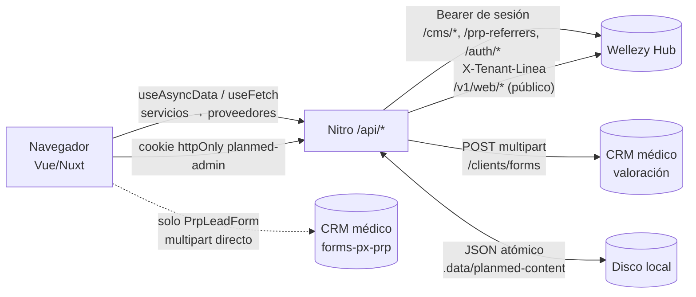
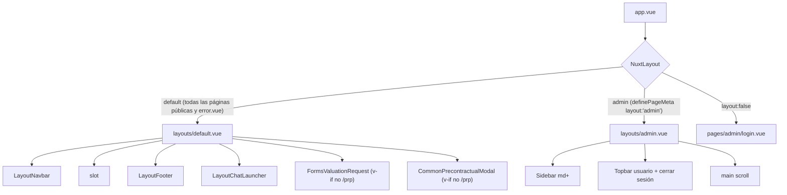

# 01 · Arquitectura general de Planmed web

> Fuente de verdad: el código del repositorio (rama `main`, último commit `32e4947`, con cambios locales sin commit). Leyenda de estados en [`00-indice-general.md`](00-indice-general.md#leyenda-de-estados).

## 1. Resumen

Planmed web es una aplicación **Nuxt 4** (Vue 3 + Nitro) con **Tailwind CSS 4**, escrita en TypeScript/JavaScript mixto. Sirve:

1. un **sitio público** de financiación de cirugía plástica (SSR),
2. un **panel administrativo** (`/admin/**`) que es un CMS ligero, y
3. una **capa de servidor Nitro** (`/api/**`) que actúa de *backend-for-frontend* contra:
   - **Wellezy Hub** (Laravel; fuente de verdad de procedimientos, noticias, “Nuestros Pacientes”, Recomendaciones, micrositios PRP y autenticación),
   - **CRM médico** externo (formulario de valoración y formulario PRP público),
   - **persistencia local en disco** del propio servidor Nuxt (página «Nosotros», «Clínicas aliadas» y tasa de usura del simulador).

El navegador **nunca** habla con Wellezy Hub: el Bearer vive en una cookie de sesión `httpOnly` sellada por Nitro. La única excepción es el formulario del micrositio PRP (`PrpLeadForm`), que envía **directo del navegador al CRM** (ver `07`).

## 2. Stack y comandos (verificado en `package.json`)

| Elemento | Valor |
|---|---|
| Framework | `nuxt` (`latest`; instalado: Nuxt 4.4.7, Vue 3.5.35, Tailwind 4.3.0), `vue`, `vue-router` |
| Estilos | `tailwindcss` + `@tailwindcss/vite` (sin `tailwind.config`; tokens en `assets/css/theme.css` con `@theme`) |
| Editor rico | `@tiptap/vue-3`, `@tiptap/starter-kit`, `@tiptap/pm` |
| Notificaciones | `sweetalert2` (envuelto en `composables/useNotify.ts`) |
| Saneado HTML | `sanitize-html` |
| SEO | `@nuxtjs/sitemap` |
| Tipos / test | `typescript`, `vue-tsc`, `@types/*`; pruebas con `node --test` |
| `npm run dev` | `nuxt dev` |
| `npm run build` | `nuxt build` (salida `.output/`, Nitro `node-server`) |
| `npm run generate` / `preview` | `nuxt generate` / `nuxt preview` (el sitio es SSR dinámico; `generate` **no** es la estrategia usada) |
| `npm run typecheck` | `nuxt typecheck` (no ejecutado en esta auditoría: reinicia el worker del dev server compartido) |
| `npm test` | `node --test "tests/**/*.test.ts"` |
| Lint | **No existe** script ni configuración de lint/prettier [no encontrado]. |

## 3. Estructura del repositorio

| Ruta | Rol | Notas |
|---|---|---|
| `app.vue`, `error.vue` | Raíz: `<NuxtLayout><NuxtPage/></NuxtLayout>`, fuentes, `trackPageView`; página de error global | `error.vue` usa el layout público y `utils/siteError.ts` |
| `pages/` | Rutas (file-based routing de Nuxt). 43 archivos | Ver `02` |
| `layouts/` | `default.vue` (público) y `admin.vue` | `login` usa `layout:false` |
| `middleware/` | `admin-auth.global.ts` (único) | Solo actúa en `/admin/**` |
| `components/` | 59 SFC en `about, admin, common, credit, forms, home, layout, news, prp, recommendations, referral, simulator, site, testimonials` | Autoimportados con prefijo de carpeta (`LayoutNavbar`, `AdminRichTextEditor`…) |
| `composables/` | `useNotify`, `useServiceUnavailable`, `useSimulator`, `useTracking`, `useTreeAction` | |
| `services/` | Fachadas singleton usadas por páginas/componentes (p. ej. `publicProcedureService`) | Capa «servicio → proveedor» |
| `providers/` | Implementaciones de acceso a datos (`Hub*Provider`, `Mock*Provider`, `CrmPrpLeadProvider`, `LocalTrackingProvider`) | Ver `07` §2 |
| `server/api/` | 57 manejadores Nitro: `admin` 36, `auth` 3, `forms` 2, `public` 16 | Ver `02` §3 |
| `server/utils/` | Lógica servidor (auth, hub, validaciones, persistencia local) | auto-importada por Nitro |
| `shared/utils/` | Módulos **puros** compartidos navegador/servidor/pruebas (alias `#shared/*`) | `aboutContent`, `financing`, `recommendationTree`, `valuation`… |
| `utils/`, `types/`, `data/` | Utilidades cliente, tipos, datos estáticos (`data/resources.ts`, `clinics.ts`, `allies.js`) | |
| `public/` | Estáticos: `images/{allies,branding,clinics,procedures,team,web}`, `documents`, `robots.txt` | |
| `tests/` | 33 archivos `*.test.ts` en 11 carpetas | Ver `11` |
| `documentacion/` | Documentación previa (`maestra/`, `guias/`, `legacy/`, 4 `.md` sueltos) + **esta carpeta** | No se modificó la previa |
| Artefactos / sueltos | `dist/`, `.output*`, `*.tar.gz`, `build-cliniplanes.zip`, `scan.cjs`, `fix.cjs`, `update_crud.js`, `scan-results.txt`, `scratch/`, `scripts/translate.cjs` | **No son parte de la app**; `translate.cjs` referencia el repo de Cliniplanes. El `typecheck` los excluye |

## 4. Capas y flujo de datos

Patrón repetido en todos los módulos:

`Página/Componente → Service (singleton) → Provider (fetch a /api/...) → Handler Nitro → server/utils → Hub | disco | CRM`

* El **navegador** solo conoce rutas `/api/**` de su propio origen.
* **Nitro** traduce el contrato del Hub (snake_case, español) al modelo de Planmed (camelCase) y viceversa; `server/utils/*.ts` contiene los `from*`/`pick*`/`translate*`.
* Los errores del Hub se clasifican (`server/utils/publicErrors.ts`): lista vacía = 200 `[]`; fallo = **503** con `data.reason` (`hub_unavailable | tenant | rejected | invalid_response`); inexistente = **404**. Las páginas convierten 503 en un aviso con reintento (`CommonHubUnavailable`) y `useServiceUnavailable` fija HTTP 503 en SSR (comprobado en ejecución, `CAPTURAS/publico/desktop__estado-hub-caido__*`).

## 5. Renderizado y reglas de ruta (`nuxt.config.ts`)

| Regla | Efecto |
|---|---|
| `/admin/**` | cabecera `X-Robots-Tag: noindex, nofollow` |
| `/`, `/nosotros`, `/recursos`, `/procedimientos/**`, `/prp/**`, `/casos-clinicos/**`, `/clinicas/**` | `ssr: true` |
| `/blog/**` | `isr: 3600` |
| `/simulador` | redirección 301 → `/financiacion` |
| `sitemap.exclude` | `/admin`, `/admin/**` |

**Hallazgo:** `/blog/**`, `/casos-clinicos/**` y `/clinicas/**` tienen regla pero **no existe ninguna página** que las sirva (resultarían 404). Son restos de planes previos [PREV]. `/simulador` sí redirige (reglas de ruta, no comprobado en ejecución).

## 6. Layouts

`layouts/default.vue` oculta el modal precontractual y el botón de valoración en `/prp/**` (`isPrpPage`). `layouts/admin.vue` tiene **barra lateral solo desde `md`**; en móvil el botón hamburguesa (`<button class="md:hidden">`) **no tiene manejador** (marcador de posición, comprobado en `CAPTURAS/admin/movil__dashboard.png`): en móvil el panel solo se navega desde las tarjetas del dashboard.

## 7. Tracking

`app.vue` observa `route.fullPath` y llama a `trackPageView`; `TrackingService` guarda un UUID de visitante en `localStorage` (`planmed_session_id`) y `LocalTrackingProvider` **solo hace `console.log`** (no hay envío a ningún sistema). El simulador emite `SIMULATOR_CALC`. [COD] No existe analítica real.

## 8. Despliegue (según el repositorio)

* Build `nuxt build` → `.output/server/index.mjs` (Nitro `node-server`, por defecto). Hay tarballs `planmed-uat-*.tar.gz` y `.output-uat-portable/` sin commit: artefactos de despliegues UAT manuales.
* El contenido local (`Nosotros`, `Clínicas`, tasa) vive en `NUXT_PLANMED_CONTENT_DIR` (por defecto `<cwd>/.data/planmed-content`), que **debe quedar fuera de `.output/`** para sobrevivir a despliegues.
* Detalles de PM2, puertos y rutas de servidor: ver la memoria/documentación operativa previa (`documentacion/maestra/09-…`, `guias/`); **no se verificaron aquí** (sin acceso SSH, fuera de alcance).
* `NUXT_TRUSTED_PROXY_HOPS` debe ajustarse al proxy real (ver `07`).

## 9. Convenciones arquitectónicas detectadas

1. **El servidor decide la autorización**; la UI solo refleja (`isAreaLeader`, `canEditRate`).
2. **Falla cerrado** en mutaciones (`assertSameOrigin`), lecturas públicas (503 ≠ vacío) y rate-limit.
3. **Sin tasa/valores de respaldo**: tasa no disponible → el simulador no muestra cuota.
4. **Validación doble**: módulo puro en `shared/utils` usado por formulario y servidor.
5. **Escritura atómica local** (`tmp` + `rename`, copia `.prev.json`) con control de concurrencia optimista (`updatedAt` → 409).
6. **Textos de usuario en español**, comentarios de código en español.
7. **Datos personales solo en memoria** en formularios (sin `localStorage`) y sin logs de payload.

## 10. Hallazgos técnicos relevantes para un tercero

| # | Hallazgo | Evidencia |
|---|---|---|
| H1 | El modal precontractual muestra literal `{'@'}` en el correo de PQRS y usa otro NIT (901532790) que la página `/informacion-precontractual` (900.794.105-6) | `CAPTURAS/publico/desktop__estado-modal-precontractual.png`; `pages/informacion-precontractual.vue:14` (comentario del propio código lo reconoce) |
| H2 | Hamburguesa del admin sin acción en móvil | `layouts/admin.vue:65` |
| H3 | Reglas de ruta huérfanas (`/blog`, `/casos-clinicos`, `/clinicas`) | `nuxt.config.ts` |
| H4 | `Estudio de créditos` es **maqueta** sin envío; `SITE_PAGES` solo administra `clinicas-aliadas` | `components/credit/CreditStudyForm.vue`, `shared/utils/sitePages.ts` |
| H5 | 9 componentes no se usan en ninguna vista (ver `06` §Huérfanos) | búsqueda de etiquetas en `pages/ layouts/ components/` |
| H6 | `Recursos` no tiene documentos (`data/resources.ts` vacío) | `pages/recursos.vue` |
| H7 | Etiqueta con errata «Fecha de Publicacin» en editor de noticias | `pages/admin/noticias/[slug].vue:106` |
| H8 | El formulario del editor de procedimientos **no** expone `recomendaciones_post/revision` aunque el servidor las acepta | `server/utils/procedures.ts` `pickProcedureBody` vs `pages/admin/procedimientos/[slug].vue` |
| H9 | `LocalTrackingProvider` solo escribe en consola | `providers/LocalTrackingProvider.ts` |
