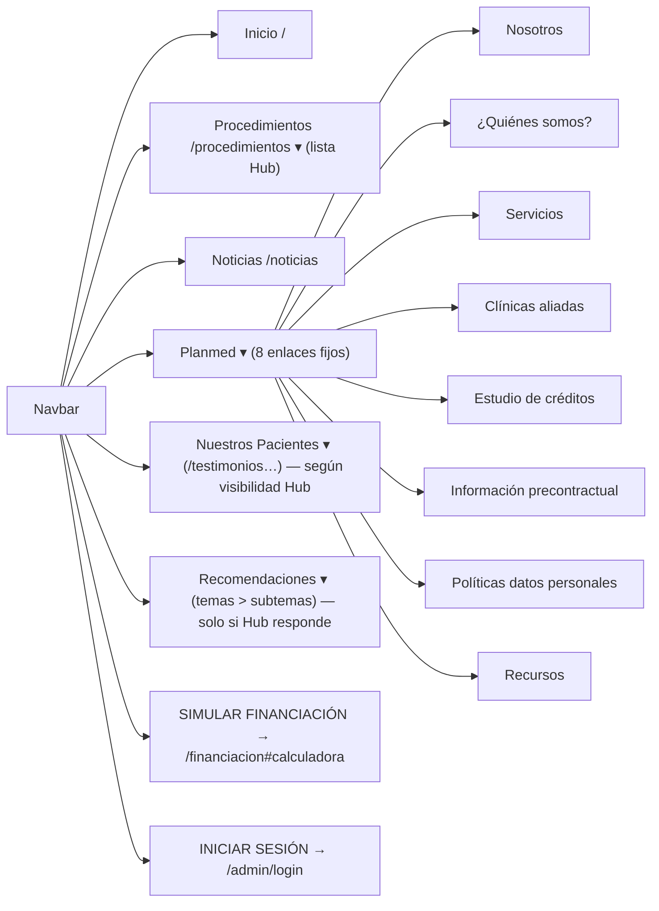

# 03 · Sitio público — descripción funcional y visual

Detalle por vista en `05-fichas-vistas/F01…F10`. Aquí: mapa de navegación, patrones y diferencias.

## 1. Jerarquía de navegación (barra principal)

Rutas públicas **no enlazadas en el menú**: `/prp/:slug` (se comparte por enlace), `/recomendaciones/cuidados|revision(/:slug)` y `/recomendaciones/:slug` (URLs heredadas/redirecciones), `/simulador` (redirección). Pie de página: redes, Documentos legales (`/recursos`), Sobre Planmed (`/nosotros`).

## 2. Patrones de interfaz del sitio
| Patrón | Dónde | Descripción |
|---|---|---|
| Cabecera editorial | procedimientos, noticias, recursos | línea superior negra, eyebrow con punto, H1 serif en mayúsculas muy grande (40→72 px) |
| `SitePageShell` | quienes-somos, servicios, estudio, legales, financiación | banda verde `#0C2619` con H1 blanco, subtítulo, slot de acciones; cuerpo en `#fcf9f8`; `wide`/`bare` |
| Secciones alternas | financiación | franjas blanco/verde de ancho completo |
| Tarjetas editoriales | listados | imagen 4:5 en gris → color al hover, categoría, título serif |
| Contenido enriquecido | todas | `CommonRichContent` (HTML saneado con lista blanca) |
| Aviso de servicio no disponible | listados | `CommonHubUnavailable` |
| Modales | valoración, precontractual, lead | `dialog`/`aria-modal`, foco atrapado, Escape |
| Botones flotantes | todas (salvo PRP) | «PIDE TU CITA» y chat |

## 3. Tipos de contenido según su origen
| Origen | Vistas | Quién lo cambia |
|---|---|---|
| **Wellezy Hub** | procedimientos, noticias, pacientes, recomendaciones, PRP, menús dinámicos | panel Planmed (proxy al Hub) o CRM/Hub |
| **Disco local administrable** | nosotros (+FAQ y contacto reutilizados en financiación/servicios), clínicas aliadas (+logos de la home), tasa del simulador | panel Planmed |
| **Código (estático)** | home, quienes-somos, servicios (texto y videos), financiación (pasos/documentos), legales, estudio de créditos, footer, chat, textos del programa de referidos | desarrollador |
| **Formularios** | valoración (CRM), inscripción PRP (Hub), lead PRP (CRM directo), lead del simulador (**mock**), estudio de créditos (**maqueta**) | — |

## 4. Funcionalidad parcial o simulada en el sitio público
1. Lead del simulador: mock, sin persistencia; WhatsApp con número marcador.
2. Estudio de créditos: maqueta sin envío.
3. Recursos: sin documentos.
4. Modal precontractual: aceptación no registrada; defectos de texto.
5. Tracking: solo consola.
6. Detalle de procedimiento: no muestra ficha técnica ni galería capturadas en el admin.

## 5. Responsive
Breakpoints Tailwind por defecto (640/768/1024/1280/1536) más el **umbral 1360 px** del menú escritorio. Verificado en capturas de 1440×900 y 390×844 para todas las rutas (`CAPTURAS/publico/`). Ver `09`.
