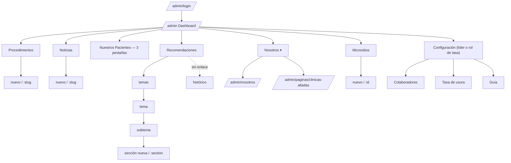

# 04 · Panel administrativo — manual funcional y técnico

Fichas: `05-fichas-vistas/A01…A09`. Autenticación y permisos: `08`.

## 1. Mapa de navegación

## 2. Módulos y operaciones realmente disponibles
| Módulo | Listar | Crear | Editar | Eliminar | Otras | Fuente de verdad |
|---|---|---|---|---|---|---|
| Procedimientos | ✔ (búsqueda local) | ✔ | ✔ (maestros: solo estado/destacado) | ✘ (activar/desactivar) | destacar, galería, imagen, SEO | Hub |
| Noticias | ✔ (búsqueda+estado) | ✔ | ✔ | ◐ «eliminar» = despublicar | publicar/programar, portada, multimedia, SEO | Hub |
| Nuestros Pacientes | (un solo formulario) | ✔ videos/casos/Instagram | ✔ | ✔ (al guardar) | orden, visibilidad, programa de referidos | Hub |
| Recomendaciones (árbol) | ✔ | ✔ tema/subtema/sección/recomendación | ✔ | ✔ solo si vacío | publicar, orden, intro, imagen, enlace corto (lectura) | Hub |
| Recomendaciones heredado | ✔ | ✔ | ✔ | ✔ (API) | — | Hub |
| Nosotros | — (documento único) | — | ✔ | — | FAQ, contacto, mapa, portada | **Disco local** |
| Clínicas aliadas | (documento) | ✔ | ✔ | ✔ | galería, documentos | **Disco local** |
| Micrositios PRP | ✔ (búsqueda, estado, paginación) | ✔ | ✔ | ✘ en UI (API sí) | activar/desactivar, copiar enlace | Hub |
| Configuración · colaboradores | ✔ (solo lectura) | ✘ | ✘ | ✘ | filtros | Hub |
| Configuración · tasa | historial | — | ✔ | — | confirmación | **Disco local** |
**Categorías del encargo que no existen:** gestión de usuarios/roles/permisos (solo lectura), formularios/solicitudes recibidas (los leads no se consultan en este panel), menús/banners/navegación editables (el menú es código + Hub), biblioteca de medios general, creación de páginas arbitrarias (`SITE_PAGES` solo admite una), configuración general del sitio (logo, colores, SEO global).

## 3. Qué se configura en el panel y qué exige código
| Se configura en el panel | Requiere cambio de código |
|---|---|
| Procedimientos y su contenido (Hub) | Menú «Planmed» y sus 8 enlaces (`Navbar.vue`), pie de página, redes del footer, chat |
| Noticias, videos/casos/Instagram, programa de referidos | Texto de home, financiación, servicios, quiénes somos, legales |
| Recomendaciones (árbol) | Lista de ciudades y plazos del simulador; rango $1M–$100M |
| Nosotros (portada, institucional, FAQ, contacto, mapa), Clínicas | Campos de los formularios (valoración, PRP, estudio de créditos) |
| Micrositios PRP | Roles autorizados (variable de entorno) |
| Tasa de usura | Paleta, tipografías, estructura de layouts |

## 4. Componentes y comportamientos transversales del panel
| Elemento | Detalle |
|---|---|
| Editor rico | `AdminRichTextEditor` (TipTap): Negrita (N), Cursiva (K), H2, H3, lista, lista numerada, Enlace, salto de línea; HTML limitado a `p, br, strong, em, h2, h3, ul, ol, li, a` |
| Imágenes | `utils/imageFile.ts` `fileToOptimizedDataUrl` (1600 px, JPEG 0.82) → data URL → servidor lo envía como multipart a Hub o lo guarda en disco |
| Notificaciones | `useNotify`: éxito (toast 3 s), advertencia (toast 6 s), error (modal), confirmación |
| Guardado | formularios de «Nosotros»/páginas con barra fija y detección de cambios; formularios Hub con botón en cabecera y redirección |
| Reordenar | botones ↑ ↓ (sin arrastrar) |
| Protección de cambios | `beforeunload`; confirmación al salir en el histórico |
| Accesibilidad | pestañas WAI-ARIA, `aria-invalid`, `role=alert`, etiquetas asociadas |

## 5. Riesgos y limitaciones observados
1. Navegación móvil rota (hamburguesa sin acción).
2. Varias pantallas cargan solo en cliente (`onMounted`/`server:false`); sin esqueleto uniforme.
3. Guardado de «Pacientes» no transaccional (mitigado con aviso de guardado parcial).
4. Desactivar/«eliminar» no borra (comportamiento del Hub); no hay papelera ni restauración visible.
5. `NUXT_SESSION_PASSWORD` ausente ⇒ 503 en toda autenticación.
6. Contenido local depende del disco del servidor: sin copia automática más allá de `*.prev.json`.
7. Todos los roles CMS tienen los mismos privilegios en la web; el Hub es la autoridad real.
8. Errata de etiqueta («Publicacin») y módulos huérfanos (histórico).
9. Capturas de panel realizadas contra un Hub **simulado de solo lectura**; los flujos de escritura se documentan por código y pruebas, no por ejecución.
