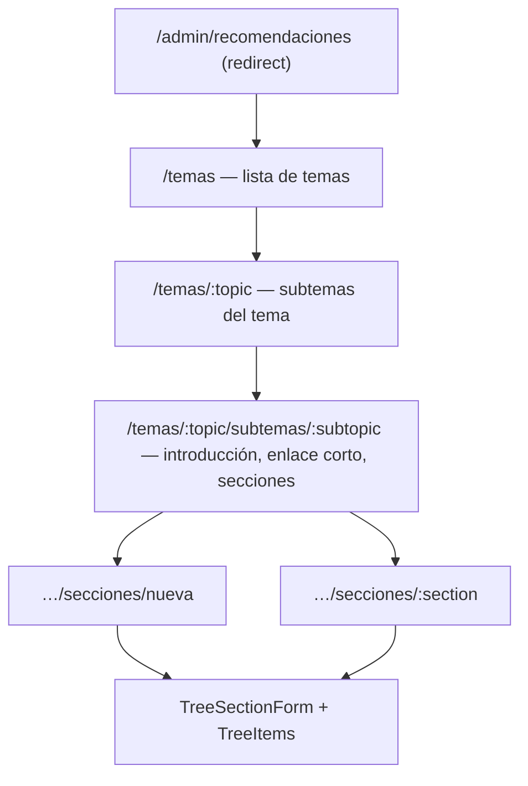

# A05 · Recomendaciones — árbol (admin)

Capturas: `CAPTURAS/admin/{desktop,movil}__recomendaciones-temas.png`, `…__recomendaciones-tema.png`, `…__recomendaciones-subtema.png`, `…__recomendaciones-seccion-nueva.png`.

## Mapa

API única: `/api/admin/recommendation-tree/**` (proxy catch-all, 32 rutas permitidas en `shared/utils/recommendationAdminApi.ts`) → Hub `/cms/recommendation-{topics,subtopics,sections,items}`; **el tema se indica solo en la ruta; el cuerpo nunca lleva empresa/línea/tema**. Escrituras **sin reintentos** (una repetición podría duplicar). Estado de acción: `useTreeAction` (`busy`, `error` con errores por campo).

## Pantallas
| Pantalla | Funciones (todas verificadas por código; vista EJ salvo la edición de sección) |
|---|---|
| **Temas** (`temas/index.vue`) | Lista ordenable (↑ ↓ → `reorder`), insignia Publicado/Oculto, nº de subtemas; **Crear tema** (título \*, texto del menú, slug opcional, «Publicar al crear»), *Abrir*, *Editar* (título, menú), *Publicar/Ocultar*, *Eliminar* (confirmación; solo sin subtemas ⇒ si no, 409 con mensaje del Hub). Estados: cargando, error con *Reintentar*, vacío, lista. |
| **Tema** (`temas/[topic]/index.vue`) | Ficha del tema (editar título/menú, publicar/ocultar; aviso «Mientras el tema esté oculto, ninguno de sus subtemas es público»), lista de subtemas ordenable con *Abrir/Publicar/Eliminar*, **Crear subtema** (título \*, texto del menú, **Categoría**: General/Cuidados/Revisión, slug opcional) ⇒ navega al subtema creado. |
| **Subtema** (`…/subtemas/[subtopic]/index.vue`) | Migas de pan; ficha (editar título, menú, categoría; publicar/ocultar; aviso si el tema está oculto); **Introducción** (texto enriquecido, video de YouTube opcional, imagen subir/quitar con confirmación); **Enlace corto del subtema** (solo lectura desde Hub: URL + «Copiar enlace»; si no hay, mensaje del Hub o error; nunca se inventa); **Secciones**: lista ordenable con tipo, resumen («3 recomendaciones (2 publicadas)» o «Texto · Imagen · Vídeo · Botón»), visible/oculta, *Editar*, *Mostrar/Ocultar*, *Eliminar* (solo sin recomendaciones), **Añadir sección**. Verifica que el subtema pertenezca al tema de la URL (si no, 404 visual). |
| **Sección** (`secciones/nueva.vue`, `[section].vue` → `TreeSectionForm`) | Tipo (catálogo de Hub `section-types`: Descripción, Recomendaciones, Callout, Contacto, Personalizada), título, **campos condicionados por tipo** (`subtitle, content, image, video, layout, cta`); al cambiar a un tipo que no admite un campo con datos, avisa y ofrece limpiarlos; imagen (subir/quitar), distribución (apilado / imagen izquierda / derecha), botón (texto + destino: **ambos o ninguno**; destino https/mailto/tel/ruta interna); en tipo *Recomendaciones*, `TreeItems` gestiona las recomendaciones individuales (título, contenido, publicar, orden, eliminar). |

Estados comunes: cargando, error (con `reason`: no autorizado, no encontrado, 409 integridad, 422 por campo, 429, 503 *transitorio* con aviso «no se sabe si el cambio llegó a guardarse»), éxito (toast), sin permiso 403 (`MSG_FORBIDDEN_WRITE`). Componentes: `TreeBreadcrumb`, `TreeNotice`, `StatusBadge`, `TreeItems`, `TreeSectionForm`, `AdminRichTextEditor`.
Verif.: EJ de las 5 pantallas con datos simulados (lectura); **ninguna escritura ejercida**. Pruebas: `tests/recommendations/{admin-tree,tree-contract,tree-server,tree-static,admin-ui,admin-errors}.test.ts` (OK).
Permisos: el panel no distingue lectura/creación/edición/eliminación; lo decide el Hub con el token del usuario (403 ⇒ mensaje).
