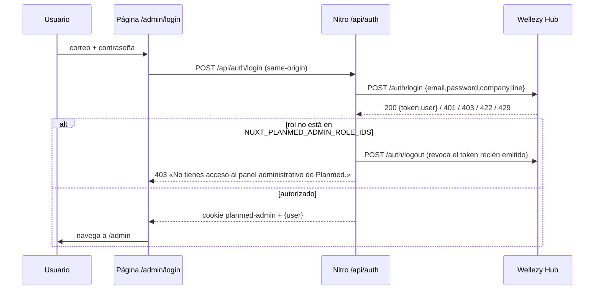

# 08 · Autenticación, permisos y sesiones

## 1. Modelo
* **Identidad**: Wellezy Hub (usuarios, roles, líder de línea). Planmed web no guarda usuarios ni contraseñas.
* **Sesión**: `useSession` de h3 (cookie sellada) — `planmed-admin`, `httpOnly`, `sameSite=lax`, `secure` fuera de desarrollo, `path=/`, **8 horas** (`SESSION_MAX_AGE`). Contiene `{token, user}` (el `user` público: id, nombre, correo, rol, `isAreaLeader`, `canEditRate`). El Bearer **nunca** llega al navegador. Falta `NUXT_SESSION_PASSWORD` (<32 c.) ⇒ 503 en toda ruta que use sesión.
* **Estado en cliente**: `authService.getUser()` = `useState('auth-user')` (por petición en SSR). `authService.can()` devuelve solo «está autenticado»: no hay permisos finos en la UI.

## 2. Flujos

**Cada navegación a `/admin/**`** (`middleware/admin-auth.global.ts`): `loadUserSession()` ⇒ `GET /api/auth/me` (revalida token y rol con Hub; si el rol fue revocado, cierra sesión y 403). Sin usuario ⇒ `/admin/login`. En `/admin/login` con usuario ⇒ `/admin`. En `/admin/configuracion*` ⇒ además `GET /api/admin/config/access`.
**Logout**: `POST /api/auth/logout` revoca en Hub y destruye la cookie aunque Hub falle; el cliente queda sin usuario y va a login.
**Expiración**: la cookie caduca a las 8 h o el token de Hub puede ser revocado: cualquier `401` limpia la sesión; la UI muestra login (rutas de página) o modal de error (acciones).

## 3. Autorización en el servidor (autoridad real)
| Capa | Regla | Archivo |
|---|---|---|
| CSRF | Toda mutación exige `Origin`, o `Sec-Fetch-Site: same-origin`, o `Referer` del mismo host; sin señal ⇒ 403 (falla cerrado). Se evalúa **antes** de leer el cuerpo | `server/utils/origin.ts` |
| Sesión | `adminSession`: sin token/usuario ⇒ 401 | `server/utils/news.ts` |
| Rol CMS | `isAuthorizedUser`: `user.role.id ∈ NUXT_PLANMED_ADMIN_ROLE_IDS` (por defecto `19`) | `server/utils/auth.ts` |
| Revalidación en escrituras locales | `requireAboutEditor` consulta `/auth/me` en cada guardado de Nosotros/Clínicas/Páginas | `aboutStore.ts` |
| Líder de la línea | `requireAreaLeader` (`is_area_leader === true` + rol CMS) para colaboradores | `auth.ts` |
| Tasa | `requireRateEditor`/`canManageFinancingRate`: líder **o** rol en `NUXT_PLANMED_RATE_EDITOR_ROLE_IDS` | `financingRate.ts` |
| Hub | Cada ruta `/cms/*` y `/prp-referrers` valida permisos y línea con el token; Planmed traduce 403 ⇒ «No tienes permiso…» | `server/utils/*` |
| Lecturas públicas | sin sesión, `X-Tenant-Linea`, 503 ≠ vacío | `wellezy.ts`, `publicErrors.ts` |
| Límites | valoración 8/10 min/IP; inscripción PRP 6/10 min/IP (IP de proxy según `NUXT_TRUSTED_PROXY_HOPS`) | `valuation.ts`, `prpEnrollment.ts`, `shared/utils/clientIp.ts` |

## 4. Matriz de permisos (módulo × perfil)
| Módulo / acción | Visitante | Rol CMS (p. ej. 19) | Líder de línea | Rol de tasa |
|---|---|---|---|---|
| Sitio público, formularios públicos | ✔ | ✔ | ✔ | ✔ |
| Dashboard, Procedimientos, Noticias, Pacientes, Recomendaciones, Nosotros, Clínicas, Micrositios (ver y editar) | ✘ (401/login) | ✔ **sujeto a permisos del Hub** | ✔ | ✔ si es rol CMS |
| Configuración › Colaboradores | ✘ | ✘ (403) | ✔ lectura | ✘ |
| Configuración › Tasa de usura | ✘ | ✘ | ✔ | ✔ |
| Configuración › Guía | ✘ | ✘ (no accede a la pantalla) | ✔ | ✔ |
Sin distinción lectura/creación/edición/eliminación en la web: «los roles autorizados tienen exactamente los mismos privilegios en el CMS» (comentario de `AuthService`); el Hub puede devolver 403 por acción. Estado real del usuario 20 y de los permisos del Hub: ver memoria/documentación previa (`documentacion/maestra/09`), **no verificado aquí**.

## 5. Rutas de página protegidas
`/admin/**` (excepto `/admin/login`): `X-Robots-Tag: noindex, nofollow` (regla de ruta) y fuera del sitemap. `/admin/paginas/:slug` con slug no registrado ⇒ 404. `/prp/**` no requiere sesión (solo `noindex` por `useSeoMeta`).

## 6. Hallazgos
1. `/admin/login` y el botón «Iniciar sesión» del sitio público muestran el panel a cualquiera como destino; no hay segundo factor ni bloqueo propio (solo el límite 429 de Hub).
2. La UI oculta Configuración a quien no es líder/tasa, pero el control real es el middleware + servidor.
3. El middleware trata cualquier error de `/config/access` distinto de 401 como 403 (incluye 503).
4. Pruebas: `tests/security/routes.test.ts` recorre **todas** las rutas `server/api/admin/**` y `auth` comprobando 403 sin origen, 401 sin sesión y que no se llama al Hub (ejecutada: OK).
