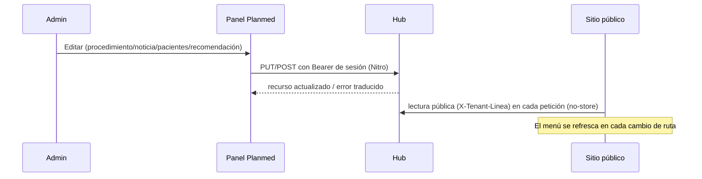

# 10 · Flujos funcionales

## F-1 Del interés a la solicitud de financiación (visitante)
```mermaid
flowchart TD
  A[Home /] -->|SIMULAR FINANCIACIÓN| B[/financiacion#calculadora]
  A --> C[/procedimientos] --> D[/procedimientos/:slug] -->|SIMULAR FINANCIACIÓN ?procedureId| B
  B --> E{Tasa disponible?}
  E -- sí --> F[Cuota estimada]
  E -- no --> G[Panel «no disponible» + Reintentar]
  F -->|SOLICITAR FINANCIACIÓN| H[LeadForm]
  H -->|"mock (sin envío real)"| I[Éxito simulado → WhatsApp con número TBD]
  X[Botón flotante PIDE TU CITA] --> V[Formulario de valoración] -->|POST /api/forms/valuation| CRM[(CRM médico)]
```
Estado: la ruta que **sí persiste** un lead es la valoración (flotante). El lead del simulador no persiste.

## F-2 Referido (PRP)
```mermaid
flowchart LR
  PRP[Admin crea micrositio] --> L[Enlace /prp/:slug compartido por el promotor]
  L --> P[Visitante abre /prp/:slug] --> F[PrpLeadForm]
  F -->|multipart directo| CRM[(CRM: code_prp)]
  R[/testimonios/programa-de-referidos] --> RF[ReferralForm] -->|POST /api/forms/prp-enrollment| HUB[(Hub idempotente)]
```

## F-3 Publicar contenido (administrador)

Contenido local (Nosotros, Clínicas, tasa): el panel escribe el JSON y la web pública lo lee en la siguiente petición; **sin Hub**.

## F-4 Cambio de la tasa de usura
Admin (líder o rol de tasa) ⇒ `/admin/configuracion?tab=tasa` ⇒ digita nueva tasa ⇒ confirmación ⇒ `PUT` con `expectedUpdatedAt` ⇒ archivo `financing-rate.json` ⇒ el simulador usa la nueva tasa en la siguiente cotización (sin caché). La home sigue mostrando su ejemplo estático.

## F-5 Recomendaciones
Admin crea Tema ⇒ Subtema (categoría General/Cuidados/Revisión) ⇒ Secciones (tipos) ⇒ publica (tema **y** subtema deben estar publicados) ⇒ aparece en el menú **RECOMENDACIONES** (tema > subtema) y en `/recomendaciones/:tema/:subtema`; el Hub genera el **enlace corto** (solo lectura en el panel) para compartir.

## F-6 Sesión de administrador
Login ⇒ cookie 8 h ⇒ cada ruta revalida con Hub ⇒ logout/expiración ⇒ login. Ver `08` §2.

## F-7 Fallo del Hub
Listados públicos: aviso + reintento y HTTP 503; detalles ⇒ `error.vue` 503 (reintentar); menú: se omiten Recomendaciones y el desplegable de Procedimientos; home/financiación siguen respondiendo 200. Verificado en ejecución (`CAPTURAS/publico/desktop__estado-hub-caido__*`).

## Relaciones entre pantallas (resumen)
Home → {Financiación, Procedimientos, Clínicas} · Procedimiento → Financiación · Recomendación → {Financiación, Procedimientos} · Pacientes → {Financiación, Recursos} · Noticia ↔ listado · Admin dashboard → módulos · Subtema (admin) → Secciones · Listado de micrositios → enlace público.
