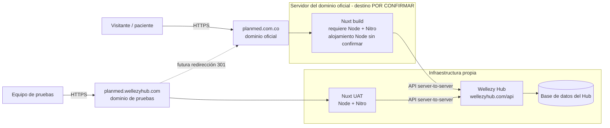
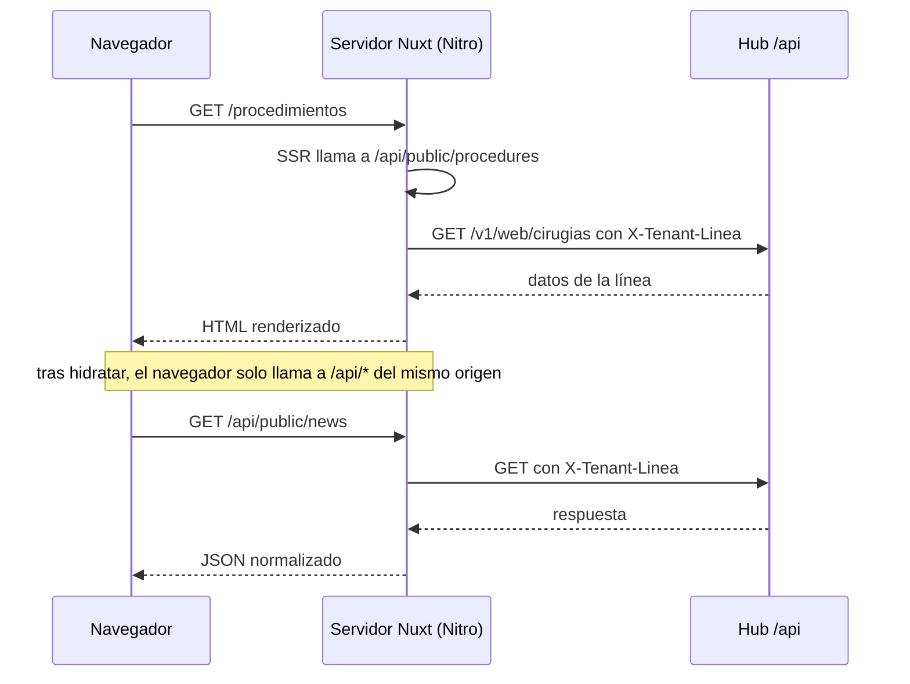
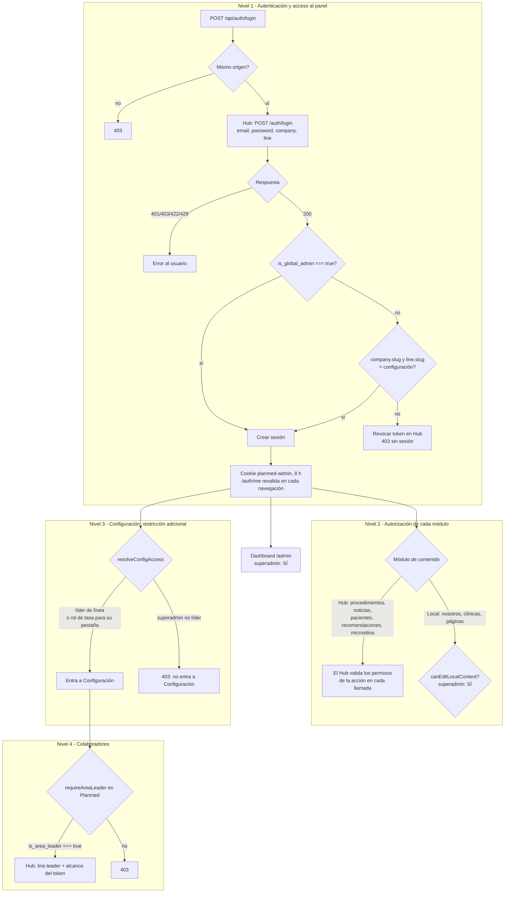
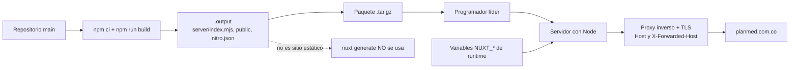
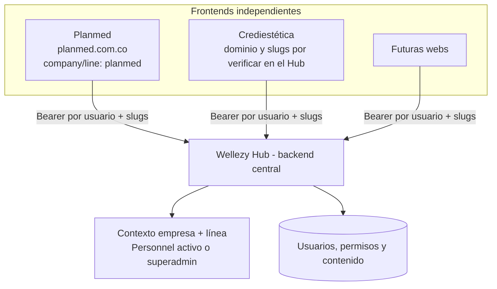

# 16 · Arquitectura de dominios, frontend, backend Hub y administración de Planmed

**Fecha:** 2026-11-04 · **Repositorio:** `planmed-web` (rama `main` = `6bf8772`) · **Hub inspeccionado:** `wellezy-hub-2`, rama `main` = `33dc762` (solo lectura)
**Propósito:** manual de referencia de Planmed y guía de arquitectura para replicar el modelo en Crediestética y futuras webs conectadas al Hub.
**Método:** el código real es la fuente de verdad. Nada se ejecutó contra servidores; no se leyeron secretos (los valores de `.env` no se reproducen).

## Leyenda de estados

| Etiqueta | Significado |
|---|---|
| **IMPL** | Implementado en el código (verificado leyendo el archivo citado) |
| **PROB** | Cubierto por una prueba automática que pasa, o probado manualmente según el responsable |
| **PEND** | No implementado |
| **PROP** | Propuesta, requiere aprobación |
| **N/V** | No verificable desde el repositorio (infraestructura, servidores, DNS) |

---

## 1. Introducción y objetivo

Planmed es un sitio público (financiación de cirugías plásticas) con un panel administrativo. Se construye con **Nuxt 4** y **no guarda usuarios, procedimientos, noticias ni recomendaciones**: esos datos viven en el **CRM Wellezy Hub**, que es el backend centralizado.

Este documento fija tres ideas que no deben confundirse:

1. **Dominio comercial** (`planmed.com.co`): lo que ve el público y lo que se posiciona en buscadores.
2. **Alojamiento del frontend**: dónde corre la aplicación Nuxt. Puede ser distinto del Hub y distinto del dominio de pruebas.
3. **Backend** (`https://wellezyhub.com/api`): lógica de negocio, usuarios, permisos y datos. El frontend, esté donde esté, sigue consumiendo este backend.

## 2. Principios arquitectónicos

1. **El frontend es un consumidor del Hub.** No crea usuarios, Personnel ni procedimientos en una base propia.
2. **El Hub decide quién eres y qué puedes hacer.** Planmed no almacena contraseñas ni roles; los lee de `/auth/me`.
3. **Empresa y línea las decide el servidor.** Nunca llegan desde el navegador: salen de la configuración de Nuxt (`NUXT_WELLEZY_*`) y del contexto del token que emite el Hub.
4. **El navegador nunca ve el token del Hub.** El Bearer vive en una cookie de sesión sellada y solo la usa el servidor Nuxt (Nitro).
5. **Patrón de capas:** `Página → Service → Provider → ruta Nitro (/api/*) → Hub`. El navegador solo habla con Nitro de su mismo origen.
6. **Fallo cerrado.** Sin configuración, sin Hub o sin señal de origen, se deniega.
7. **Dominio canónico ≠ URL del backend ≠ dominio de pruebas.** Son tres parámetros independientes (§6 y §13).

## 3. Arquitectura de dominios

| Elemento | Dominio / URL | Responsabilidad | Estado |
|---|---|---|---|
| Dominio oficial | `https://planmed.com.co` | Acceso público al frontend; URL canónica de SEO | Es la URL canónica en el código (`nuxt.config.ts` → `site.url`). Qué servidor lo atiende hoy: **N/V** |
| Dominio de pruebas (UAT) | `https://planmed.wellezyhub.com` | Pruebas actuales; futura redirección 301 a `planmed.com.co` | Funciona para pruebas (el responsable confirmó login y panel). La configuración del servidor: **N/V** |
| Backend Hub | `https://wellezyhub.com/api` | Autenticación, datos y lógica de negocio | Valor de `NUXT_WELLEZY_API_BASE_URL` documentado en `.env.example` |
| Servidor del frontend de pruebas | Infraestructura propia (VPS) | Ejecutar Nuxt (Node/Nitro) | Proceso y puerto: **N/V** en el repositorio (ver nota) |
| Servidor del dominio oficial | Externo (alojamiento del cliente) | Publicar el build entregado | Hoy alojaría una página WordPress; **N/V**. **Destino no resuelto**: falta confirmar con el programador líder que el alojamiento ejecuta Node.js |

> **Nota sobre puertos y procesos.** El repositorio no contiene configuración de Nginx, PM2 ni de puertos (se buscó). El traspaso previo del equipo menciona PM2 `planmed-web-next` en el puerto 3004 para UAT y `planmed-web` en el 3003 para producción, ambos tras Nginx Proxy Manager, pero **ese dato no está en el repositorio y no se verificó**. Debe confirmarlo quien administra el VPS antes de citarlo como definitivo. El mismo traspaso describe `planmed.com.co` como ya atendido desde nuestra infraestructura, lo que **contradice** el escenario de este documento (servidor externo con WordPress). Hay que aclarar cuál es el estado real antes de planificar el corte.

### 3.1 Qué cambia al publicar en `planmed.com.co`

- El público entra por `planmed.com.co`; el build que recibe el programador líder reemplaza la web WordPress.
- Las **API del Hub no se mueven**: el frontend publicado sigue apuntando a `https://wellezyhub.com/api` (variable de runtime).
- `planmed.wellezyhub.com` deja de ser un sitio y pasa a **redirigir (301) a `planmed.com.co`**, conservando la ruta. Esa redirección se configura en nuestra infraestructura (proxy), no en la aplicación. Mientras el dominio de pruebas siga sirviendo contenido, debe llevar `noindex` o estar protegido (pendiente de decisión, §16).

### 3.2 Qué se configura dónde

| Configuración | Servidor externo (dominio oficial) | Nuestra infraestructura |
|---|---|---|
| Certificado TLS y DNS de `planmed.com.co` | Sí (o su proveedor DNS) | No |
| Proceso Node que ejecuta el build y proxy a ese proceso | Sí | No |
| Variables `NUXT_*` del runtime | Sí (en el entorno del proceso) | Solo las de UAT |
| Redirección 301 `planmed.wellezyhub.com → planmed.com.co` | No | Sí |
| Hub, base de datos, CORS/Sanctum | No | Sí |
| Autorizar el origen del nuevo servidor si el Hub aplica listas de orígenes | No | Sí (**N/V**; las llamadas son servidor a servidor, ver §5) |

## 4. Distribución de servidores y responsabilidades

| Componente | Dónde se ejecuta | Qué hace |
|---|---|---|
| Páginas Vue / hidratación | **Navegador** | Interfaz; llama solo a `/api/*` del mismo origen |
| Nitro (`server/api/**`, `server/utils/**`) | **Servidor Nuxt** (Node) | Valida origen, maneja la sesión, llama al Hub con el Bearer, devuelve datos mínimos |
| Renderizado SSR de páginas públicas | **Servidor Nuxt** | Consulta Nitro/Hub al renderizar y entrega HTML |
| Autenticación, usuarios, Personnel, permisos, contenido (procedimientos, noticias, recomendaciones, micrositios PRP, pacientes) | **Hub** | Fuente de verdad |
| Contenido local (Nosotros, Clínicas aliadas, páginas informativas, tasa del simulador) | **Disco del servidor Nuxt** (`NUXT_PLANMED_CONTENT_DIR`) | No pasa por el Hub |
| Formularios de valoración y PRP | Navegador → Nitro → CRM externo/Hub | Ver §8.3 |

> **Consecuencia importante:** el contenido local vive en el sistema de archivos del servidor donde corre Nuxt (`server/utils/aboutStore.ts`, `financingRate.ts`). Si el build se publica en un servidor distinto, ese contenido **no se traslada solo**. Hay que migrar el directorio o aceptar que parte de cero (la tasa arranca en 2 %).

## 5. Flujo de funcionamiento

1. El visitante abre `https://planmed.com.co`.
2. El navegador recibe del servidor Nuxt el HTML renderizado (SSR) y los recursos estáticos.
3. Para datos públicos, las páginas llaman a **rutas Nitro de su mismo origen** (`/api/public/procedures`, `/api/public/news`, …) mediante `useAsyncData`, `useFetch` y los *providers* `HubPublic*Provider`. En el render inicial esas llamadas ocurren **en el servidor**; tras la hidratación, las siguientes ocurren desde el navegador hacia Nitro.
4. Nitro llama al Hub (`wellezyPublicGet`, `server/utils/wellezy.ts`) con la cabecera `X-Tenant-Linea` tomada de `NUXT_WELLEZY_LINE_SLUG`. **El navegador nunca llama directamente a `wellezyhub.com`.**
5. El Hub identifica la línea, ejecuta la consulta y responde. Nitro normaliza (descarta campos desconocidos) y responde al navegador.
6. Una indisponibilidad del Hub se devuelve como 503, no como lista vacía (`publicErrors.ts`).

### 5.1 Quién llama a quién (verificado en el código)

| Llamada | Origen | Destino | Archivos |
|---|---|---|---|
| Lecturas públicas | Servidor Nuxt (SSR) y navegador → Nitro | Nitro → Hub | `providers/HubPublic*Provider.ts`, `server/api/public/**`, `wellezyPublicGet` |
| Login, `me`, logout | Navegador → Nitro | Nitro → Hub `/auth/*` | `providers/WellezyAuthProvider.ts`, `server/api/auth/*` |
| Administración (Hub) | Navegador → Nitro (con cookie) | Nitro → Hub `/cms/*`, `/prp-referrers` con Bearer | `providers/Hub*Provider.ts`, `server/api/admin/**`, `wellezyRequest` |
| Colaboradores (lectura) | Navegador → Nitro | Nitro → Hub `GET /cms/line-users` | `services/LineUsersService.ts`, `server/utils/lineUsers.ts` |
| Valoración | Navegador → Nitro `POST /api/forms/valuation` | Nitro → CRM médico externo (`crmValuationUrl`) | `services/ValuationService.ts`, `server/utils/valuation.ts` |
| Inscripción PRP | Navegador → Nitro `POST /api/forms/prp-enrollment` | Nitro → Hub | `services/ReferralService.ts`, `server/utils/prpEnrollment.ts` |
| Formulario PRP del CRM médico | **Navegador → CRM externo directamente** | `crmPrpFormUrl` | `providers/CrmPrpLeadProvider.ts` (única llamada directa del navegador a un tercero; requiere CORS en ese CRM) |
| Contenido local | Navegador → Nitro | Disco del servidor | `server/utils/aboutStore.ts`, `clinics.ts`, `sitePages.ts` |

### 5.2 Sesión

- Cookie `planmed-admin`: `httpOnly`, `SameSite=Lax`, `Secure` fuera de desarrollo, `path=/`, **sin atributo Domain**, duración 8 horas (`sessionOptions` en `server/utils/auth.ts`). **IMPL**
- Contenido de la sesión: `{ token, user }`; el `user` público contiene id, nombre, correo, rol, `isAreaLeader` y banderas derivadas (`canEditRate`, `canCreatePrp`, `canEditPrp`, `canDeletePrp`, `canEditContent`). Nunca incluye la lista de permisos ni el token. **IMPL / PROB**
- Falta `NUXT_SESSION_PASSWORD` (mínimo 32 caracteres) → 503 en las rutas con sesión. **IMPL**
- Al no tener atributo Domain, la cookie pertenece al host que sirve la app: la sesión de `planmed.wellezyhub.com` **no** vale en `planmed.com.co` y viceversa (hay que iniciar sesión de nuevo tras el corte).
- Cambiar `NUXT_SESSION_PASSWORD` invalida todas las sesiones.

## 6. Configuración de variables

Verificadas en `nuxt.config.ts` (`runtimeConfig`) y `.env.example`. Nuxt convierte `runtimeConfig.camelCase` en `NUXT_CAMEL_CASE` y lee el valor **al arrancar el proceso** (runtime), no al compilar.

| Variable | Clave en runtimeConfig | Qué controla | Se lee en | Valor Planmed |
|---|---|---|---|---|
| `NUXT_WELLEZY_API_BASE_URL` | `wellezyApiBaseUrl` | URL base de la API del Hub; **debe terminar en `/api`**. Solo servidor | runtime | `https://wellezyhub.com/api` (local: `http://localhost:8000/api`) |
| `NUXT_WELLEZY_COMPANY_SLUG` | `wellezyCompanySlug` | Slug de empresa en el login y en la validación de pertenencia | runtime | `planmed` (por defecto en el código) |
| `NUXT_WELLEZY_LINE_SLUG` | `wellezyLineSlug` | Slug de línea: login, `X-Tenant-Linea` y pertenencia | runtime | `planmed` (por defecto) |
| `NUXT_SESSION_PASSWORD` | `sessionPassword` | Sella la cookie de sesión (≥32 caracteres) | runtime | secreto, no documentado aquí |
| `NUXT_PLANMED_CONTENT_DIR` | `planmedContentDir` | Carpeta persistente del contenido local, fuera de `.output/`. Vacío = `./.data/planmed-content` | runtime | por definir en cada servidor |
| `NUXT_TRUSTED_PROXY_HOPS` | `trustedProxyHops` | Proxies de confianza para leer la IP real (límites de PRP/valoración) | runtime | 0 por defecto |
| `NUXT_PLANMED_CONTENT_EDITOR_ROLE_IDS` | `planmedContentEditorRoleIds` | IDs de rol adicionales que **escriben contenido local** (no dan acceso al panel) | runtime | vacío |
| `NUXT_PLANMED_RATE_EDITOR_ROLE_IDS` | `planmedRateEditorRoleIds` | IDs de rol que además del líder editan la tasa (no dan acceso al panel) | runtime | `19` por defecto |
| `NUXT_PLANMED_ADMIN_ROLE_IDS` | `planmedAdminRoleIds` | **Ya no interviene en el acceso** (ver §7.4) | — | existe por compatibilidad |
| `NUXT_CRM_VALUATION_URL` | `crmValuationUrl` | Destino servidor→CRM del formulario de valoración | runtime | URL por defecto en el código |
| `NUXT_PUBLIC_CRM_PRP_FORM_URL` | `public.crmPrpFormUrl` | Destino navegador→CRM del formulario PRP (público) | runtime | URL por defecto en el código |

`NUXT_PUBLIC_API_BASE_URL` **no** pertenece a Planmed (es de Crediestética).

### 6.1 URL canónica: `site.url`, `NUXT_PUBLIC_SITE_URL`, `NUXT_SITE_URL`

Las controla el módulo `nuxt-site-config` (v4.0.8, dependencia de `@nuxtjs/sitemap`). Se verificó leyendo `node_modules/nuxt-site-config/dist/runtime/server/middleware/init.js` y `site-config-stack`.

| Fuente | Prioridad | Qué es |
|---|---|---|
| Origen de la petición (`Host`) | −4 (la más baja) | `nitro:init`: lo que el servidor deduce del Host |
| `site.url` en `nuxt.config.ts` | −3 | **`https://planmed.com.co`** (queda guardado en la configuración compilada) |
| `NUXT_PUBLIC_SITE_URL` / `NUXT_SITE_URL` | 0 (la más alta) | Variable de entorno leída **en tiempo de ejecución** |

Reglas prácticas:

- **Prevalece la de mayor prioridad:** variable de entorno > `site.url` del código > Host de la petición.
- Por eso `planmed.wellezyhub.com` **no se convierte en canónico** por servirse desde allí: el Host tiene la prioridad más baja. Solo pasaría si alguien definiera `NUXT_SITE_URL` o `NUXT_PUBLIC_SITE_URL` con ese dominio.
- Valores recomendados: **producción** `https://planmed.com.co` (basta el valor del código; definir la variable con el mismo valor es válido y explícito). **UAT**: dejar también `https://planmed.com.co` si se quiere que las pruebas validen el canónico definitivo; usar `https://planmed.wellezyhub.com` solo si se desea que el UAT se autorreferencie, aceptando que ese build no refleja el canónico final. En ningún caso debe haber un valor distinto en producción.
- `public/robots.txt` tiene la línea `Sitemap:` **fija** a `https://planmed.com.co/sitemap.xml`. No sigue a la variable. En UAT apuntará al dominio oficial.
- Las páginas con canonical propio lo arman con `useSiteConfig().url` (`pages/nosotros.vue`, `pages/procedimientos/index.vue`, `pages/estudio-de-creditos.vue`, `components/site/ManagedPage.vue`, `pages/financiacion.vue`).
- `public.localDomain: 'planmed.com.co'` existe en `nuxt.config.ts` pero **no se usa en el código** (se buscó). No sirve para nada hoy.
- Regla SEO obligatoria del título: ver `15-regla-seo-titulo-obligatorio.md`.

La URL del backend (`NUXT_WELLEZY_API_BASE_URL`) y la URL canónica (`site.url`) **no se relacionan**: cambiar una no afecta a la otra.

## 7. Autenticación y autorización

### 7.1 Login (`server/api/auth/login.post.ts`) — IMPL, PROB

1. `assertSameOrigin` (mutación: exige Origin / Sec-Fetch-Site / Referer del mismo host; sin señal → 403).
2. `wellezyLogin` → `POST {API}/auth/login` con `{email, password, company, line}` (los slugs salen de la configuración, no del navegador).
3. Códigos del Hub: 200 sigue; 401 credenciales; 403 sin acceso al contexto; 422; 429; otro → 503.
4. Se aplica `isAuthorizedUser` (política de §7.3). Si falla, **se revoca el token recién emitido** (`wellezyLogout`) y no se crea sesión (403).
5. Si pasa, se guarda `{token, user público}` en la cookie sellada.

### 7.2 `/auth/me` y validación continua — IMPL, PROB

- `GET /api/auth/me` revalida el token contra `GET {API}/auth/me` y reaplica `isAuthorizedUser`. Si el usuario dejó de estar autorizado, cierra la sesión y revoca el token. Un 503 del Hub **no** destruye la sesión.
- El middleware `middleware/admin-auth.global.ts` llama a `loadUserSession()` en cada navegación a `/admin/**`. Es solo experiencia de usuario: **la autoridad está en el servidor**, que vuelve a consultar el Hub en operaciones sensibles (`requireAreaLeader`, `resolveConfigAccess`, `requireRateEditor`, escrituras locales).
- `/auth/me` del Hub devuelve `company.slug`, `line.slug`, `role`, `is_area_leader`, `is_global_admin` y `permissions` (Hub: `ApiAuthUserResource`). `normalizeUser` (`server/utils/wellezy.ts`) conserva solo los campos conocidos, exige `is_global_admin === true` estricto y reduce `permissions` a cadenas.

### 7.3 Política vigente (`server/utils/auth.ts`, `isAuthorizedUser`) — IMPL, PROB (`tests/security/panel-access.test.ts`, 37/37)

| Caso | Resultado |
|---|---|
| `is_global_admin === true` (verificado por el Hub desde `users.is_superadmin`) | **Entra** sin pertenecer a la empresa/línea |
| Cualquier otro usuario (con cualquier rol, incluido `admin`) | Entra **solo si** `company.slug` y `line.slug` que devuelve el Hub coinciden con `NUXT_WELLEZY_COMPANY_SLUG` / `NUXT_WELLEZY_LINE_SLUG` (comparación sin distinguir mayúsculas) |
| Faltan slugs en la configuración o en la respuesta del Hub | **Denegado** |

El Hub aplica la misma regla en `ApiAccessService::validateAccess`: un usuario normal necesita un **Personnel activo** en esa empresa y línea; el superadmin entra con un contexto virtual (sin crear registros) y solo a líneas activas.

### 7.4 Contraste con la política que se debe conservar

| Requisito | Estado en el código |
|---|---|
| Superadmin global = `is_global_admin === true` | **Conforme** (`isAuthorizedUser`, `wellezy.ts`) |
| El rol `admin` no concede acceso global | **Conforme**: `isAuthorizedUser` no mira nombres ni IDs de rol |
| Usuario normal con Personnel activo en la empresa y línea | **Conforme**: lo exige el Hub; Planmed comprueba los slugs |
| El superadmin entra pero no es líder | **Conforme**: el contexto virtual tiene `is_area_leader=false`; `requireAreaLeader` lo rechaza (prueba en `authorization.test.ts`) |
| No recuperar acceso global con listas de IDs de rol | **Conforme para el acceso**: `allowedRoleIds()` sigue definida pero **ninguna parte del código la usa** (código muerto, conviene eliminarla). Existen otras dos listas de IDs, **con otro propósito**: `rateEditorRoleIds` (editar la tasa) y `contentEditorRoleIds` (escribir contenido local). Ambas exigen primero `isAuthorizedUser` y no dan acceso al panel |

**Diferencias detectadas:** (a) `NUXT_PLANMED_ADMIN_ROLE_IDS` sigue en `nuxt.config.ts` y `.env.example` con valor `19`, aunque ya no actúa; puede confundir. (b) `services/AuthService.ts` conserva un comentario antiguo («los roles autorizados tienen los mismos privilegios… `user.role.id`») que ya no describe la implementación. (c) La documentación `08-autenticacion-permisos-sesiones.md` describe la política anterior (rol en `NUXT_PLANMED_ADMIN_ROLE_IDS`); **este documento la reemplaza** en lo relativo al acceso.

### 7.5 Superadmin global, administrador normal, líder de línea y usuarios con permisos específicos

**Hay cuatro niveles de autorización distintos. Superar uno no implica superar los demás.** Entrar al panel (§7.3) no hace al superadmin líder de línea ni le abre todas las funcionalidades.

| Nivel | Qué lo decide | Dónde se aplica |
|---|---|---|
| 1. Acceso al panel y dashboard | `isAuthorizedUser`: superadmin global, o pertenencia a la empresa y línea | Login, `/auth/me`, `middleware/admin-auth.global.ts` |
| 2. Módulos de contenido | Permisos que devuelve el Hub (Procedimientos, Noticias, Pacientes, Recomendaciones, Micrositios) y `canEditLocalContent` (Nosotros, Clínicas, páginas) | El Hub en cada llamada; `server/utils/auth.ts` para el contenido local |
| 3. Configuración | Autorización **específica**: `resolveConfigAccess` exige líder de línea, o líder/rol de tasa para esa pestaña | `GET /api/admin/config/access` y el middleware para `/admin/configuracion*` |
| 4. Colaboradores y tasa | Colaboradores: `requireAreaLeader` en Planmed y `line.leader` en el Hub. Tasa: `canManageFinancingRate` (líder o rol en la lista de tasa) | `server/utils/lineUsers.ts`, `financingRate.ts`; Hub `EnsureAreaLeader` |

**Matriz.** «Comprobado» = verificado manualmente por el responsable con un usuario superadmin (UAT). «Código» = deducido de la lectura del código, sin comprobación manual.

| Función | Superadmin global | Rol `admin` normal | Líder de línea | Usuario con permisos específicos |
|---|---|---|---|---|
| Identificación | `users.is_superadmin` → `is_global_admin` | Rol principal en `personnels.role_id` | `personnels.is_area_leader = true` | Rol/permisos del Hub |
| Iniciar sesión e ingresar a `/admin` | **Sí** (comprobado) | Solo con Personnel activo en Planmed (código) | Sí (código) | Solo con Personnel activo en Planmed (código) |
| Dashboard | **Sí** (comprobado) | Sí (código) | Sí (código) | Sí (código) |
| Procedimientos, Noticias, Nuestros pacientes, Recomendaciones, Micrositios | **Sí, conforme a los permisos de cada módulo** (comprobado) | Según los permisos de su rol en el Hub (código) | Según los permisos de su rol en el Hub (código) | Según sus permisos en el Hub (código) |
| Nosotros, Clínicas, páginas (contenido local) | **Sí** (comprobado para Nosotros; `canEditLocalContent` lo permite siempre al superadmin) | Sí, `admin` está en la lista por nombre (código) | Solo si su rol es editor de contenido (código) | Solo si su rol es editor de contenido o su ID está en la lista opcional (código) |
| **Configuración** (pantalla) | **No** (comprobado) | No (código) | **Sí** (código) | Solo la pestaña de tasa, si su rol está en la lista de tasa (código) |
| Configuración › Colaboradores | **No** | No | Sí, solo lectura hoy | No |
| Configuración › Tasa de usura | **No** | No | Sí | Solo si su rol está en la lista de tasa |
| Configuración › Guía | **No** (está dentro de Configuración) | No | Sí | Sí, si accede a la pantalla |

`canEditLocalContent` reconoce roles por nombre (`administrador de contenido de línea`, `diseñador gráfico`, `admin`, `superadmin`, `super_admin`) o por IDs opcionales, y siempre al superadmin global.

**Por qué el superadmin no entra a Configuración.** `resolveConfigAccess` calcula `canManageLine = isAuthorizedUser && is_area_leader === true` y `canManageRate = canManageFinancingRate(...)`. Un superadmin cuyo contexto en Planmed no sea el de un líder (contexto virtual del Hub, sin rol principal y con `is_area_leader=false`, o un Personnel que no sea líder) no cumple ninguna de las dos y recibe 403; el middleware lo traduce en la pantalla de error. El comportamiento observado **coincide con el código**; no hay contradicción.

**Qué falta para cerrar la explicación (no es una contradicción).** Este documento no afirma cuál es la situación concreta del usuario con el que se probó: no consta si no tiene Personnel en la línea (se usa el contexto virtual) o si tiene uno que no es de líder. Para dejarlo documentado hace falta consultar en el Hub, solo lectura, el Personnel de ese usuario en la empresa y línea de Planmed, y la respuesta de `/auth/me` (`role`, `is_area_leader`, `is_global_admin`). No se asume que tenga un Personnel de líder: si lo tuviera, el código le daría acceso a Configuración, y eso no ocurre.

### 7.6 Operaciones reservadas al líder

`requireAreaLeader` (`server/utils/auth.ts`): `isAuthorizedUser` **y** `is_area_leader === true`. Hoy lo usa `GET /api/admin/config/line-users`. `resolveConfigAccess` decide qué pestañas de Configuración se muestran (`canManageLine`: líder; `canManageRate`: líder o rol de tasa).

## 8. Integración con el Hub

### 8.1 Cliente (`server/utils/wellezy.ts`) — IMPL

- Funciones: `wellezyLogin`, `wellezyMe`, `wellezyLogout`, `wellezyRequest` (autenticada), `wellezyUpload` (multipart), `wellezyPublicGet` y `wellezyPublicPost` (sin Bearer, con `X-Tenant-Linea`).
- Tiempo máximo 10 s (30 s en subidas), sin reintentos, sin registrar URLs ni cuerpos en logs.
- `wellezyRequest` solo admite los métodos GET, POST, PUT y DELETE; **no admite PATCH**, que necesitará el cambio de estado de colaboradores.

### 8.2 Endpoints del Hub consumidos hoy (grep en `server/`)

`/auth/login`, `/auth/me`, `/auth/logout`, `/cms/procedures`, `/cms/posts`, `/cms/before-after-cases`, `/cms/recommendation-pages`, `/cms/line-users` (solo GET), `/prp-referrers` y las rutas públicas bajo `/v1/web/*` (`cirugias`, `posts`, `patient-section`, `recommendation-pages`, `recommendation-topics`, `prp/{slug}` y `POST prp-enrollments`) con `X-Tenant-Linea`. Los permisos finos y la línea los impone el Hub en cada llamada; Planmed traduce los 403 a mensajes.

### 8.3 Dependencias externas distintas del Hub

Formulario de valoración (CRM médico, servidor→servidor) y formulario PRP (CRM médico, navegador→CRM). Si el nuevo hosting restringe salidas, ambos destinos deben estar permitidos.

## 9. Panel administrativo

Rutas (`pages/admin/**`): inicio, procedimientos, noticias, testimonios, recomendaciones, nosotros, páginas, micrositios, configuración. El panel lleva `X-Robots-Tag: noindex, nofollow` (`routeRules` `/admin/**`) y está fuera del sitemap. Detalle por vista: `04-panel-administrativo.md` y `05-fichas-vistas/A*.md`.

**Acceso por niveles (ver §7.5).** El superadmin global inicia sesión, entra a `/admin`, ve el dashboard y administra los módulos de contenido conforme a los permisos de cada módulo (comprobado manualmente). **Configuración** (colaboradores, tasa de usura y guía) tiene una autorización propia y hoy el superadmin **no** puede ingresar a ella. El acceso global al panel no lo convierte en líder de línea.

## 10. Gestión de colaboradores

### 10.1 Estado actual en Planmed

| Función | Estado |
|---|---|
| Listar colaboradores con usuario en el Hub | **IMPL, PROB** (`tests/about/line-users.test.ts`; probado manualmente por el responsable) |
| Buscar por nombre o correo (debounce 350 ms) y filtrar por estado | **IMPL, PROB** (`tests/about/line-users-search.test.ts`, 14 pruebas, **aún sin commitear**) |
| Columnas: nombre, correo, rol, estado, marca de líder | **IMPL** (`components/admin/LineUsersPanel.vue`) |
| Crear colaborador | **PEND** (no existe ruta Nitro, servicio ni formulario) |
| Consultar opciones y catálogos del formulario | **PEND** en Planmed (existe en el Hub) |
| Activar o desactivar | **PEND** en Planmed (existe en el Hub); la pantalla lo declara «todavía no disponible» |
| Auditoría de operaciones | **PEND** (ver §10.3) |

Esto es el estado actual, **no una funcionalidad terminada**.

### 10.2 API del Hub (verificada en `wellezy-hub-2`, commit `33dc762`)

Todas bajo `/api/cms`, middleware `auth:sanctum` + `api.context` + `line.leader` (`routes/api.php`). Documentación del Hub: `docs/cms/colaboradores-admin-api.md`. Pruebas del Hub: `tests/Feature/Api/Cms/LineUserTest.php` (59/59 junto con `tests/Feature/HumanResource`, ejecutadas en la base de pruebas local).

| Endpoint | Qué hace | Detalle |
|---|---|---|
| `GET /line-users` | Lista paginada | `search` (nombre, apellido, correo), `status`, `per_page` (máx. 100). Devuelve `{id, user_id, name, email, role{id,name}, status, is_area_leader}` |
| `GET /line-users/options` | Catálogos del formulario | empresa y línea (solo informativas), departamentos, cargos, **roles asignables**, sedes, clínicas, áreas |
| `POST /line-users` | Alta | Crea en **una transacción**: `users`, `role_user`, departamento, `personnels`, `personnel_contracts`. 201 con el recurso; sin contraseña ni hash en la respuesta |
| `PATCH /line-users/{personnel}/status` | Activa o desactiva | Valida `status`; 404 si el Personnel no es de la empresa/línea del token; **403 si el objetivo es líder** (incluido uno mismo) |

**Cómo se determinan empresa y línea:** del Personnel del contexto del token (`api_personnel`, resuelto por `EnsureApiTokenContext`). `company_id` y `linea_id` del cuerpo se ignoran. Todas las llaves foráneas del formulario deben pertenecer a ese alcance (`LineUserOptions`).

**Datos del alta.** Obligatorios: `name`, `lastname`, `email` (único en `users`), `document_type`, `document_number` (no repetido por tipo dentro de la empresa; **sin índice único en base de datos**, la comprobación es consultar y luego insertar), `password` + confirmación (política `Password::defaults`), `role_id`, `base_salary`, `transportation_assistance`. Opcionales: teléfono, dirección, fecha de ingreso, estado, departamento, cargo, sede, clínica, área. `is_area_leader: true` se **rechaza** (422).

**Roles asignables:** política cerrada. Hoy solo «Asesora financiera», y únicamente si el rol es global y tiene **exactamente** los permisos del seeder `AsesoraFinancieraRoleSeeder`. Si no coincide, no se ofrece y el POST da 422. Que ese rol exista así en producción: **N/V**.

**Validaciones y errores:** 401 sin token; 403 no líder o sin acceso al contexto; 422 validación; 500 genérico sin detalles internos. No hay idempotencia por llave: tras un fallo de red hay que consultar el listado por correo antes de reenviar.

**Lo que Planmed ya consume:** solo `GET /line-users` (con `search`, `status`, `page`, `per_page`). Faltan `options`, `POST` y `PATCH`.

### 10.3 Limitaciones detectadas

1. **Superadmin bloqueado (punto crítico).** El contexto virtual del superadmin tiene `is_area_leader=false`. El middleware `line.leader` (`EnsureAreaLeader`) devuelve 403, y además `LineUserOptions::roles()` exige que el solicitante sea el líder activo del contexto. Resultado: **un superadmin que no sea también líder no puede listar, crear ni cambiar estados de colaboradores**, ni en el Hub (`line.leader`) ni en el portal (`requireAreaLeader`, y la pantalla Configuración que los aloja). Coincide con lo comprobado manualmente: el superadmin entra al panel y a los módulos de contenido, pero no a Configuración. Es coherente con «el superadmin no es líder», pero choca con el objetivo de que los usuarios autorizados administren colaboradores.
2. **Sin auditoría.** Existe `AuditLogger::log()` en el Hub, pero `LineUserController` no lo invoca en `store` ni `updateStatus` (solo registra errores en el log técnico).
3. **Un correo existente no se puede asociar.** `users.email` es único; no hay flujo para crear un Personnel de un usuario ya existente (otra línea u otra empresa).
4. **Permisos globales por usuario.** `role_user` y los permisos efectivos no están acotados por empresa/línea y `User::personnel` es `hasOne`. Si un mismo usuario tuviera Personnel en dos líneas, sus roles valdrían en ambas. Condiciona cualquier flujo de «asociar existente».
5. **Contraseña inicial** definida por quien crea; no hay correo de invitación ni cambio obligatorio en el primer acceso.
6. **Datos de nómina obligatorios** (`base_salary`, `transportation_assistance`) para un alta que nace en un portal web.
7. **Correo sin normalizar** al crear (el login sí pasa a minúsculas); mitigado si la colación de MySQL es insensible a mayúsculas (**N/V**).
8. **Inactivo.** Un Personnel inactivo pierde acceso a la API; si bloquea también el login web del Hub: **N/V** (no se encontró comprobación en `app/Actions/Fortify`).

### 10.4 Alternativas para el superadmin (sin implementar)

| Opción | Descripción | Evaluación |
|---|---|---|
| A. Marcar al contexto virtual como líder | Poner `is_area_leader=true` en `globalAdminContext` | **Descartada**: convierte al superadmin en líder en todas las rutas; viola la política |
| B. Nuevo middleware `line.manager` | Permite líder **o** `is_global_admin`, solo para las rutas de colaboradores, limitado a la empresa/línea del token. Ajustar `LineUserOptions::roles()` para aceptar el contexto del superadmin | **Recomendada a corto plazo**: cambio acotado, no toca la identidad del superadmin |
| C. Permiso explícito `line_users.manage` | Un permiso del Hub que el rol del líder tiene y el superadmin obtiene por `hasPermission`; el middleware verifica permiso + contexto | **Recomendada a largo plazo**: modelo uniforme, requiere seeder y despliegue de permisos |
| D. Crear un Personnel de líder para el superadmin | Dato de datos, no de código | **No recomendada**: lo hace líder de verdad y contamina listados y nómina |
| E. Cuenta de servicio o token de sistema desde Planmed | Saltar la identidad del usuario | **Descartada**: pierde trazabilidad y rompe el principio de identidad por usuario |

En cualquiera de las alternativas viables, Planmed debe ajustar también `resolveConfigAccess` / `requireAreaLeader` para decidir quién ve la pestaña, y el Hub debe seguir validando por su cuenta. La empresa y la línea siguen saliendo del token.

### 10.5 Matriz de requisitos funcionales

| # | Requisito | Hub | Planmed |
|---|---|---|---|
| 1 | Consultar | IMPL | IMPL |
| 2 | Buscar y filtrar | IMPL | IMPL |
| 3 | Crear | IMPL | PEND |
| 4 | Opciones y catálogos | IMPL | PEND |
| 5 | Activar/desactivar | IMPL | PEND |
| 6 | Respetar empresa y línea | IMPL (token) | IMPL (sin enviar IDs) |
| 7 | Auditoría | PEND | PEND |
| 8 | Aislamiento entre empresas/líneas | IMPL, PROB (pruebas del Hub) | Delegado al Hub |
| 9 | Superadmin gestiona colaboradores sin ser líder (hoy no puede: no accede a Configuración) | PEND (decisión §10.4) | PEND |

## 11. Build y publicación

### 11.1 Qué es el build — IMPL

`npm run build` (`nuxt build`) usa Nitro con el preset **`node-server`** (comprobado en `.output/nitro.json`). Genera `.output/` con `server/index.mjs` (servidor HTTP Node), `server/node_modules` (dependencias ya incluidas), `public/` (recursos estáticos) y `nitro.json`. Arranque: `node .output/server/index.mjs`.

**Contiene:** el servidor Nuxt (SSR + rutas `/api/*`), los recursos del cliente y las dependencias de servidor empaquetadas.
**No contiene:** el Hub, su base de datos, los secretos (`NUXT_*`), el contenido local (`NUXT_PLANMED_CONTENT_DIR`), ni la configuración del proxy o del certificado.

### 11.2 ¿Se puede publicar como archivos estáticos? **No.**

El proyecto depende de ejecución en servidor: SSR obligatorio (`routeRules` con `ssr: true` para el menú compartido con datos del Hub), ~57 rutas `server/api/**` (sesión, proxy al Hub, formularios), cookie de sesión y escritura de archivos locales. `nuxt generate` existe como script pero **no es el procedimiento de este proyecto**: produciría un sitio sin login, sin panel y con datos congelados. El alojamiento del dominio oficial **debe poder ejecutar Node.js** y un proxy inverso hacia ese proceso. Si el servidor externo solo sirve PHP/archivos (como WordPress), el build **no es autosuficiente** y hace falta otro mecanismo (p. ej. que el dominio oficial apunte por proxy o DNS a un Node que controlemos). Esto debe confirmarse con el programador líder **antes** de comprometer fechas.

### 11.3 Requisitos de Node

Nuxt 4.4.7 exige Node ^22.12 o ^24.11. La versión instalada en el servidor: **N/V**.

### 11.4 Variables: build frente a runtime

- **Durante el build:** ninguna es imprescindible. `site.url` se fija desde `nuxt.config.ts` y las páginas dinámicas no se prerenderizan.
- **En runtime (proceso Node):** todas las de §6. En particular `NUXT_WELLEZY_API_BASE_URL`, `NUXT_SESSION_PASSWORD`, los slugs y, si se quiere sobrescribir el canónico, `NUXT_PUBLIC_SITE_URL`.

### 11.5 Procedimiento de build y entrega (descriptivo; no ejecutado)

1. Partir de `main` limpio y de la versión de Node correcta.
2. `npm ci` (usa `package-lock.json`) y `npm run build`.
3. Comprobar que existe `.output/server/index.mjs`.
4. Empaquetar **solo** `.output/` en un `.tar.gz` (el repositorio ya contiene entregas anteriores `planmed-uat-*.tar.gz`; su contenido de nivel superior es `nitro.json`, `public`, `server`).
5. Entregar al programador líder junto con: lista de variables (sin valores secretos en el mismo canal), versión de Node, comando de arranque y puerto.
6. En el servidor: descomprimir en un directorio nuevo, definir variables, arrancar con un gestor de procesos y apuntar el proxy inverso a ese puerto. **No usar `git pull` como método de actualización**: antes del 6-oct-2026 `.output` estuvo versionado y un pull puede pisar el build vigente (traspaso previo, **N/V**).
7. El contenido local (`NUXT_PLANMED_CONTENT_DIR`) debe quedar fuera del directorio del build para sobrevivir a las actualizaciones.

### 11.6 Qué debe configurar el servidor externo

Node.js compatible; proceso persistente con reinicio; proxy inverso con TLS que reenvíe todas las rutas (incluido `/api/*`) y las cabeceras `Host` y `X-Forwarded-Host` (la protección CSRF compara el Origin con `x-forwarded-host` o `host`; si el proxy envía un Host interno, las mutaciones darán 403); salida HTTPS hacia `wellezyhub.com` y hacia el CRM médico; directorio persistente y escribible para el contenido local; `NUXT_TRUSTED_PROXY_HOPS=1` solo si hay un único proxy de confianza.

### 11.7 Verificación posterior a la publicación

1. `GET /api/public/procedures` responde 200 desde el dominio oficial (no 503) → el servidor alcanza el Hub.
2. Iniciar sesión en `/admin/login` → 200 y cookie `planmed-admin` en `planmed.com.co`.
3. `GET /api/auth/me` autenticado → 200 con `company.slug` y `line.slug` = `planmed`.
4. Ver el código fuente de `/`: `<link rel="canonical">` y `og:url` con `https://planmed.com.co`; `<title>` con la frase obligatoria (doc `15`).
5. `https://planmed.com.co/sitemap.xml` y `robots.txt` correctos; `/admin/**` con `X-Robots-Tag: noindex, nofollow`.
6. Confirmar que el Hub registra los accesos desde el nuevo origen.
7. **Enlaces a PDF:** `pages/politica-datos-personales.vue` enlaza cuatro documentos a `https://planmed.com.co/wp-content/uploads/...`. Al reemplazar WordPress, esos archivos **dejarán de existir** y los enlaces darán 404 salvo que se migren o se conserve esa ruta. Hallazgo de riesgo (§16).

## 12. Seguridad

- **CSRF:** `assertSameOrigin` en toda mutación; falla cerrado (`server/utils/origin.ts`). IMPL, PROB.
- **Secretos:** solo en el servidor; el Bearer nunca llega al navegador; `.env` está ignorado por Git.
- **Revalidación:** el servidor reconsulta al Hub en operaciones sensibles; no confía en la cookie.
- **Límites de uso:** valoración 8 por 10 min por IP; PRP 6 por 10 min por IP (`NUXT_TRUSTED_PROXY_HOPS`).
- **Indexación:** panel con `noindex`; sin bloqueo en `robots.txt` a propósito.
- **Principio de menor privilegio:** el rol `admin` no da acceso global; el superadmin no es líder; el Hub impone permisos por acción.
- **Cuidado:** el token del Hub dura 8 h (`API_AUTH_TOKEN_TTL_MINUTES`, por defecto 480) y la cookie 8 h; se revocan en logout.

## 13. Replicación en otras webs

### 13.1 Qué es igual y qué cambia

| Permanece igual | Cambia en cada sitio |
|---|---|
| Patrón `Página → Service → Provider → Nitro → Hub` | Marca, contenido, módulos habilitados |
| Cliente `wellezy.ts` y `normalizeUser` | `NUXT_WELLEZY_COMPANY_SLUG` y `NUXT_WELLEZY_LINE_SLUG` |
| Política de acceso (§7.3) y `assertSameOrigin` | Dominio comercial, dominio de pruebas, URL canónica |
| Sesión por cookie sellada, Bearer solo en servidor | `NUXT_SESSION_PASSWORD` (uno por sitio) |
| Build Nitro `node-server` | Servidor, puerto y proxy |
| Contrato de la API del Hub | Permisos y roles concretos de cada línea en el Hub |

### 13.2 Tabla de parámetros para un sitio nuevo

| Parámetro | Planmed | Nuevo sitio |
|---|---|---|
| Dominio público | `planmed.com.co` | Definir |
| Dominio de pruebas | `planmed.wellezyhub.com` | Definir; no crear subdominios sin acuerdo |
| URL canónica (`site.url` / `NUXT_PUBLIC_SITE_URL`) | `https://planmed.com.co` | Debe ser el dominio público |
| URL del backend (`NUXT_WELLEZY_API_BASE_URL`) | `https://wellezyhub.com/api` | Mismo Hub, debe terminar en `/api` |
| Company slug | `planmed` | **Verificar en el Hub** (tabla `companies.slug`) |
| Line slug | `planmed` | **Verificar en el Hub** (`lineas.slug`, de la empresa indicada) |
| Sesión | cookie `planmed-admin` + `NUXT_SESSION_PASSWORD` | Nombre de cookie propio y secreto propio |
| Contenido local | `NUXT_PLANMED_CONTENT_DIR` | Directorio propio y persistente |
| Build | `nuxt build`, preset `node-server` | Igual |
| Despliegue | Node + proxy | Según el hosting; confirmar que admite Node |

**Crediestética no debe asumir los slugs ni los dominios de Planmed.** Hay que comprobar en el Hub qué empresa y línea existen, que estén activas y que haya Personnel activo para los usuarios que deban entrar. La auditoría previa de Crediestética (fuera de este repositorio) indica que usa un vínculo local `admin_users` y `NUXT_PUBLIC_API_BASE_URL`; migrar a este modelo es una decisión aparte (`13` y `14`).

## 14. Checklist para un nuevo sitio

1. Crear o confirmar en el Hub la empresa y la línea (activas) y sus slugs.
2. Crear roles y Personnel de prueba; confirmar un líder.
3. Definir dominios: público, pruebas, canónico.
4. Clonar la estructura base; fijar `site.url` al dominio público.
5. Configurar `NUXT_WELLEZY_*`, secreto de sesión, directorio de contenido.
6. Verificar `POST /auth/login` y `GET /auth/me` contra el Hub: slugs y `is_global_admin`.
7. Comprobar permisos del panel con un usuario de la línea, uno de otra línea (debe dar 403) y un superadmin.
8. Ejecutar la batería de pruebas; reproducir los criterios de §11.7.
9. Confirmar que el hosting ejecuta Node; si no, replantear.
10. Configurar el proxy con `Host`/`X-Forwarded-Host` correctos.
11. Redirección del dominio de pruebas al definitivo y `noindex` mientras tanto.
12. Revisar enlaces a recursos del sitio anterior (PDF, imágenes) antes del corte.

## 15. Estado actual de Planmed

| Elemento | Estado |
|---|---|
| Política de acceso por superadmin | `main` = `6bf8772`, publicado en GitHub; PROB (37 + 21 pruebas). Despliegue de esta versión: PEND |
| Superadmin en UAT (comprobado manualmente por el responsable) | Puede iniciar sesión, entrar a `/admin`, ver el dashboard y administrar procedimientos, noticias, nuestros pacientes, recomendaciones, nosotros y micrositios, conforme a los permisos de cada módulo. **No puede acceder a Configuración** (colaboradores, tasa y guía). Coincide con el código (§7.5) |
| Pruebas, ejecución en servidor (reportada por el responsable; comando, fecha y commit no registrados) | 533 pruebas: **486 correctas, 32 fallidas, 15 omitidas**. No se declara la suite aprobada |
| Pruebas, ejecución local (`npm test`, 2026-11-04, `main` = `6bf8772` más pruebas locales sin commitear) | 568 pruebas: 538 correctas, 15 fallidas; las 15 restantes no fueron clasificadas en esa lectura. No se declara la suite aprobada |
| Typecheck | Servidor: sin errores, con advertencias preexistentes (reportado por el responsable). Local: `npm run typecheck` con salida 0 y 0 errores TS, con las mismas advertencias de imports duplicados |
| Colaboradores | Solo lectura |
| Archivos locales sin commitear | `tests/security/authorization.test.ts`, `tests/about/line-users-search.test.ts`, cambios en `tests/about/*` y `tests/financing/rate-store.test.ts`, entregas `.tar.gz` |

**Conciliación de las cifras de pruebas (sin forzarla).** Las dos ejecuciones son distintas y se registran por separado.
- El total local (568) menos las dos suites sin commitear, `tests/security/authorization.test.ts` (21) y `tests/about/line-users-search.test.ts` (14), da 533, que es el total del servidor. Es una **hipótesis**: sugiere que el servidor corrió el árbol versionado sin esas dos suites. No está confirmada.
- Lo que **no** concilia: el servidor reporta 486 correctas y 32 fallidas; la ejecución local reporta 538 correctas y 15 fallidas. Aun restando las 35 pruebas locales no versionadas, la diferencia en fallos (32 frente a 15) requiere explicación.
- Falta registrar para la ejecución del servidor: comando exacto, fecha, commit, versión de Node y si faltaban archivos o variables de entorno. Hasta tenerlos, **los 32 fallos del servidor se tratan como no explicados** y no se afirma que sean los 15 preexistentes.

## 16. Pendientes, riesgos y decisiones

### Pendientes
1. Desplegar `6bf8772` donde corresponda y completar las pruebas de: rol `admin` sin pertenencia y usuario de otra línea (el superadmin ya fue probado manualmente en UAT, §15).
2. Implementar el alta y el cambio de estado de colaboradores en Planmed (rutas Nitro, servicio, formulario; agregar `PATCH` a `wellezyRequest`).
3. Resolver la incompatibilidad superadmin/`line.leader` (§10.4).
4. Auditoría de colaboradores en el Hub.
5. Eliminar `allowedRoleIds` y retirar `NUXT_PLANMED_ADMIN_ROLE_IDS`; actualizar el comentario de `AuthService` y el doc `08`.
6. Commitear o descartar los tests locales (decisión del responsable).
7. Redirección 301 de `planmed.wellezyhub.com` a `planmed.com.co` tras el corte.

### Riesgos
- **Alojamiento Node.js sin confirmar.** El servidor de destino del dominio oficial **no está resuelto**: falta confirmar con el programador líder que admite Node.js. Si el servidor externo es solo WordPress/PHP, el build no se puede ejecutar allí.
- **Contenido local no portable.** Nosotros, Clínicas, páginas y tasa viven en disco.
- **PDF en `wp-content/uploads`** dejarán de existir.
- **Sesión por host:** tras el corte hay que volver a iniciar sesión.
- **`Host`/`X-Forwarded-Host` mal propagados** → 403 en login y mutaciones.
- **El traspaso previo contradice el escenario** (producción `planmed.com.co` en nuestro VPS frente a servidor externo): aclarar antes de actuar.
- **Roles de colaboradores** dependen de que «Asesora financiera» exista con permisos exactos en producción (N/V).
- **Permisos globales por usuario** en el Hub (§10.3.4).
- **Estado de la suite sin cerrar.** Hay fallos en ambas ejecuciones (15 en la local, 32 en la del servidor) y no se han conciliado (§15). No se debe dar por aprobada hasta explicar la diferencia.
- **Dominio de pruebas indexable** si no se protege mientras exista.

### Decisiones que requieren aprobación
1. Alternativa para el superadmin (B o C de §10.4) y si podrá asignar roles distintos de «Asesora financiera».
2. Dónde se atenderá realmente `planmed.com.co` (servidor externo con Node o proxy a nuestra infraestructura).
3. Valor de `NUXT_PUBLIC_SITE_URL` en UAT.
4. Contraseña inicial: temporal con cambio forzado, o enlace de restablecimiento.
5. Si `base_salary` y `transportation_assistance` deben seguir siendo obligatorios en el alta desde Planmed.
6. Si se permite asociar usuarios existentes (requiere resolver permisos por línea).
7. Migrar o no los PDF y el contenido local.

## 17. Glosario

| Término | Significado |
|---|---|
| **Hub** | CRM Wellezy; backend y fuente de verdad (`wellezyhub.com`) |
| **Nitro** | Motor de servidor de Nuxt; ejecuta `server/api/**` |
| **SSR** | Renderizado en servidor: el HTML se genera por petición |
| **Preset `node-server`** | Compilación que produce un servidor HTTP Node |
| **Build / `.output`** | Resultado de `nuxt build`: servidor + estáticos |
| **Runtime config** | Valores que el proceso lee al arrancar (`NUXT_*`) |
| **Slug** | Identificador de texto de una empresa o línea |
| **Contexto** | Pareja empresa + línea con la que el Hub emitió el token |
| **Personnel** | Registro de personal del Hub (puede o no tener usuario) |
| **Superadmin global** | `users.is_superadmin`; en Planmed `is_global_admin === true` |
| **Líder de línea** | `personnels.is_area_leader = true` |
| **`line.leader`** | Middleware del Hub que exige ser líder del contexto |
| **Canónica** | URL oficial que declaran las páginas para SEO |
| **UAT** | Entorno de pruebas de aceptación |
| **CSRF** | Ataque de petición entre sitios; se mitiga comprobando el origen |

## 18. Diagramas

### 18.1 Arquitectura general de dominios y servidores

### 18.2 Navegación y consumo de API

### 18.3 Autenticación y autorización (cuatro niveles)

El superadmin supera los niveles 1 y 2, pero **no** el 3: Configuración exige ser líder de línea (o rol de tasa para esa pestaña) y el superadmin no es líder. El nivel 4 en el Hub (`line.leader`) tampoco lo admite, por la misma razón. Las alternativas para que gestione colaboradores sin ser líder están en §10.4 y no están implementadas.

### 18.4 Build y publicación

### 18.5 Planmed, Crediestética y el Hub

